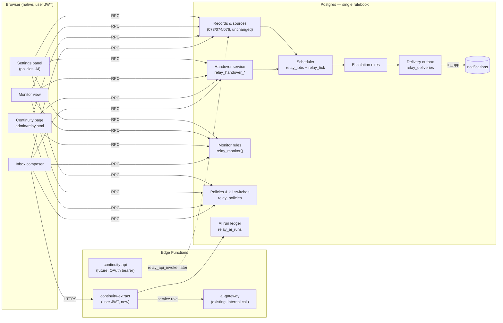
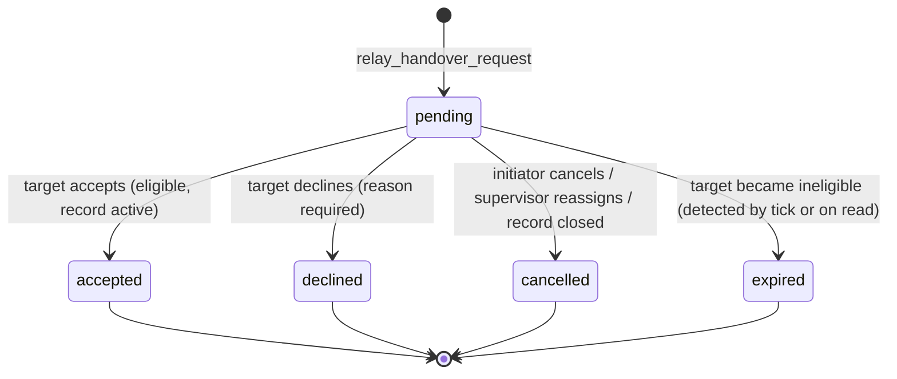

# Mad3oom Continuity — Current-State Audit and Architecture Proposal

> **Status:** proposal only. Nothing in §5–§12 is implemented.
> - Prepared on 2026-10-12 against `origin/main` at `b2a45ce` (PR #111).
> - Production was read-only: `list_migrations` and `SELECT` only.
> - No migration, configuration, data or notification was changed anywhere.
>
> **Companion documents:**
> - `docs/relay/RELAY_CURRENT_ARCHITECTURE_AR.md`: the as-built description, verified on 2026-10-12.
> - `docs/relay/RELAY_ARCHITECTURE_AND_IMPLEMENTATION_PLAN.md`: the original plan and decision log (C1–C8, P1–P4, T1–T3, M1–M11).
>
> **Evidence labels:**
> - **[repo]**: read in this checkout.
> - **[prod]**: read-only query against Supabase project `srnelrdpqkcntbgudyto`.
> - **[test]**: executed in this session (§13 lists commands and results).
> - **[assumption]**: not verified.
>
> **Folder note:** this proposal lives in `docs/relay/` on purpose. All existing Relay decisions and install notes are there, and splitting the history across two folders would make it harder to audit. New product-facing docs can use the Continuity name inside this folder.

---

## 0. Executive summary

**What exists today.** Relay is a production-grade **record core**. It already provides:
- creation from selected inbox messages, with protected excerpts;
- ownership and assignment rules;
- a status lifecycle;
- source trash and owner-only erase;
- an append-only audit log;
- a daily retention sweep.

It is live in production and enabled for platform staff.

**What is missing.** Everything that keeps work alive *after* creation:
- employee-to-employee handover;
- reminders, escalation and notifications;
- the continuity monitor;
- AI extraction;
- the external API and company workspaces.

**Recommended approach.**
- **Name:** rename the *product surface* to **Mad3oom Continuity**. Keep every `relay_*` database object, RPC, file and URL.
- **Placement:** add each missing capability as its own additive migration **behind its own kill switch, default off**, so applying a migration changes nothing for users until a separate enablement decision.
- **Engine:** build one scheduler (`relay_jobs` + `relay_tick`) and one delivery outbox (`relay_deliveries`). Reminders, handover reminders and escalations all ride on them.
- **AI:** keep it strictly optional. Route it through a new user-authenticated Edge Function that reuses `ai-gateway` server-to-server and never falls back to an unintended provider.

**Recommended first increment (§12):**
- Continuity naming and logo on the product surface only.
- The documentation-drift fixes.
- The policy and kill-switch foundation migration (`077`), with tests.

Two items need your decision before that work starts:
- **Product decisions:** H1 (may an ordinary owner propose a handover?) and D1–D4 (reminder and escalation defaults). See §11.
- **Separate security fix:** a pre-existing stored-XSS path in the admin notification list (§2.4 F1). Continuity notifications would flow through that list, so it should be fixed first, and it needs your approval because it is outside Continuity.

---

## 1. What exists today (verified)

### 1.1 Repository and production baseline
| Item | Evidence | Value |
|---|---|---|
| `origin/main` | [repo] `git fetch` | `b2a45ce`. Unchanged since the 2026-10-12 architecture report. Only one other PR is open (#113, whitepaper, unrelated) |
| Working tree | [repo] | Clean. Branch `claude/wizardly-keller-tuauoa` = `main` + the as-built doc commit |
| Relay migrations in repo | [repo] | `073_relay_core`, `074_relay_phase_c`, `076_relay_trash_owner`, each with a rollback. `075_workspace_layouts` is unrelated. Next free number: **077** |
| Production migration head | [prod] | `20261009193924 076_relay_trash_owner`. 073 (`20261009133459`) and 074 (`20261009152023`) are applied |
| Relay enabled | [prod] | `relay_workspaces(kind='platform').enabled = true` |
| Data | [prod] | 2 records, 9 sources, 5 redacted snapshots, 17 events, 0 assign grants, **0 inbox teams** |
| Cron | [prod] | `relay-retention-sweep` (`17 3 * * *`) is active; last run 2026-10-12 03:17 UTC. Other jobs: `sla-breach-check`, `inbox-dispatch-scheduled` (every minute), `data-retention-cleanup`, `expire-stale-subscriptions-hourly`, `oauth-cleanup-daily`, `emp_ops_*` |
| Relay functions | [prod] | 57 `relay_*`/`_relay_*` functions; exactly **19** executable by `authenticated` |

### 1.2 Relay capability inventory
Full detail is in the as-built doc. Summary:

| Area | Implemented | Where |
|---|---|---|
| Record model | `follow_up`, `issue`. `handover` and `ready_for_handover` are rejected with `0A000` | 073 |
| Lifecycle | `open ↔ scheduled ↔ in_progress ↔ waiting`, `→ resolved/cancelled` (reason required), reopen with reason. Optimistic `version` lock | 073 `relay_transition` |
| Ownership | `owner_id`, `team_id`. P3 (create for others only with the assign privilege) and P4 (owner may only take or release). Explicit grants in `relay_assigners`, owner-only since 076 | 074, 076 |
| Sources | `mad3oom_message` only. The server copies the excerpt. Dedupe, sensitive-content gate (M1), trash, owner-only erase | 073, 076 |
| Excerpt protection | Re-checked per read: record access **and** current `inbox_can_access` on the origin session. Fails closed. Never in list, lookup or events | 073 `_relay_source_view` |
| Retention | Read mask at `closed_at + 8760h`, plus the daily physical sweep. Reopening after expiry redacts immediately | 073 |
| Audit | `relay_events`, append-only by trigger. Free text is stored as sha256 only | 073 |
| Idempotency | `(created_by, idempotency_key)` + server-side `request_hash`; concurrent-safe insert | 073 |
| UI | Inbox composer (3 steps), `admin/relay.html` (list, detail, trash, grants), sidebar link, in-page dialogs | Phase C, PR #110 |
| Tests | 3 node files (42 tests) and 3 SQL files (62 PASS checks) | §13 |

### 1.3 Platform subsystems Continuity would reuse

| Subsystem | What exists [repo/prod] | Consequence for Continuity |
|---|---|---|
| **In-app notifications** | Table `notifications` (`user_id, title, message, type, link, category, action, action_target, action_label`). Category and action are derived by triggers when null. The admin sidebar loads the caller's rows and subscribes to Realtime. Clicking navigates to `link` | Reuse it as the first delivery channel. Add category `continuity` and action `open_relay_record`. No `CHECK` constraints need changing (verified in the 2026-10-09 baseline) |
| **Notification visibility** | RLS lets `has_elevated_authority()` read **all** notifications. Staff may insert notifications for any user | Notification text must never carry record titles or excerpts. Fixed templates plus a record id only |
| **Scheduler pattern** | `inbox_dispatch_scheduled` (058): `pg_cron` every minute; `FOR UPDATE SKIP LOCKED`; re-validates at fire time; per-item exception block; failure is recorded as `failed` + event + notification. Tested with two real concurrent sessions | Copy this pattern for `relay_tick`. Do **not** reuse `scheduled_messages` (WhatsApp-specific) or the `emp_ops` engine |
| **Staff alerts (Telegram)** | `check_sla_breaches()` sends Telegram alerts to `profiles.telegram_chat_id` for staff with `'sla_breach' = ANY(telegram_alert_events)`. It includes the ticket title | A possible later delivery channel. It must use privacy-safe templates, unlike the SLA alert |
| **Working hours** | `working_hours` (7 rows, `day_of_week`, `is_working_day`, `start_time`, `end_time`) and `advanced_settings` keys `after_hours` and `sla_config` [prod] | Escalation can defer to the next working window using the existing table. No new calendar is needed |
| **Shifts** | `emp_ops.shifts` exists, **0** `shift_assignments` [prod]. It is a separate product, isolated by rule ③ of 035 | No shift-triggered automation in this program (decision C7 stands) |
| **AI** | `ai-gateway` Edge Function: catalog → router (`ai_routing_rules` by mode, capability or default) → protocol adapter → provider, with usage logged to `ai_usage_events`. Credentials live in `external_integrations.credentials_encrypted` (AES-GCM, key in env `INTEGRATIONS_ENC_KEY`), managed from `admin/mcp.html` (AI tab). **It accepts only `is_admin()` callers or internal service-role calls.** Prod: 8 active AI integrations, modes `chat, reason, code, build, debug, review, refactor`, **one** routing rule (`mode=chat`) | Support staff cannot call `ai-gateway` directly. Extraction needs its own user-authenticated function that calls the gateway internally. With no `continuity` rule the router **falls back to the highest-priority integration** (a `custom` provider at priority 50): an unintended data destination. §8 forbids that fallback |
| **Inbox "handoff"** | 059/060 use *handoff* for **bot ↔ human** control of a conversation (`inbox_take_over`, `handoff_to_human`) | Continuity must use **handover** for employee ↔ employee transfer (the term the existing `kind='handover'` and `ready_for_handover` already use). Never reuse "handoff" |
| **OAuth 2.1 server** | `oauth-*` functions, opaque scoped tokens, PKCE. `_relay_via_api()` already treats non-native claims as least privilege | It is the base for a future `continuity-api` (§9). Not built now |

---

## 2. Gaps, discrepancies and pre-existing risks

### 2.1 Missing or partial capabilities
| Capability | State |
|---|---|
| Employee handover | Missing. Schema placeholders only (`kind='handover'`, status `ready_for_handover`) |
| Reminders and deadlines | `due_at`/`due_tz` stored with DST-safe parsing; `overdue` derived for display. **No scheduler, no reminders** |
| Escalation | Missing |
| Notifications | Missing (Relay writes none) |
| Continuity monitor | Missing. The closest is the list filter "unassigned" |
| AI extraction | Missing. Deterministic keyword category and explicit-date detection only |
| Manual creation without a conversation | The RPC supports it; **no UI** |
| Issue fields (`known_facts`, `unknowns`, `resolution_criteria`) | The RPC supports them; the UI sends only `problem` |
| Deleted-source stamping (`source_deleted_at`) and notice M3 | Column exists; nothing writes it (derived on read instead) |
| `relay_sources.access_state`, `relay_workspaces.default_timezone` | Present but unused |
| External API, company workspaces | Missing. `_relay_via_api()` exists as a least-privilege stub |

### 2.2 Documentation vs. code vs. production
| # | Discrepancy | Truth |
|---|---|---|
| X1 | Plan header says Phase B is "not applied, not enabled" | 073/074/076 are applied and Relay is enabled [prod] |
| X2 | `tests/company-navigation.test.mjs:491` comment says 076 is "not applied to production" | Applied `20261009193924` [prod] |
| X3 | `RELAY_PHASE_C_PROD_INSTALL.md` and `RELAY_076_PROD_INSTALL.md` are titled "NOT EXECUTED" | Both were executed. Only §27.5 of the plan records the 074 apply; nothing records the 076 apply |
| X4 | `relay-model.js` `EVENT_LABELS.source_purged` | The server never emits it; erase appears as `source_redacted` with `purged: true` |
| X5 | Status `scheduled` is accepted by the server | Not offered by the UI and has no scheduler semantics. §6.2 gives it a meaning or retires it from the UI |
| X6 | Plan §14 designed `relay_jobs`/`relay_tick` | Not built. Only the retention sweep was pulled forward into 073 |

### 2.3 Inherited Relay risks still open
U2 (free text visible to every record viewer), U3 (backups), U4 (no legal review), U5 (active records never expire), U12 (`relay_list` evaluates access before `limit`), U13 (residual excerpt hashes), U15 (revoked assigner's past assignments remain), U16/U17 (suggestion coverage, Chromium-only UI tests). Details are in the as-built doc §18.

### 2.4 Pre-existing platform issues that affect this program (found during this audit)
| # | Finding | Evidence | Impact on Continuity | Recommendation |
|---|---|---|---|---|
| **F1** | **Stored XSS sink in the admin notification list.** `assets/js/admin/sidebar.js:72-73` interpolates `n.title` and `n.message` into `innerHTML` unescaped. Notification rows can contain attacker-influenced text: (a) RLS lets **any** platform staff insert a notification for **any** user (`"Staff can create notifications for any user"`); (b) `inbox_assign` writes `'محادثة مع ' || customer full_name` into `message` (055:533–541), and the customer controls `full_name` — I found no constraint or guard on that column [repo + prod-shape fixture]; (c) the inbox mention notice copies 140 characters of internal-note text | [repo] code reading only. **Not exploited, not tested.** | Continuity reminders and escalations would be delivered through this list. Shipping them before F1 is fixed adds traffic to a known sink | A **separate, small PR**: escape both fields in `sidebar.js` (and audit the other notification renderers). It is outside Continuity scope, so it needs your go-ahead. Recommended **before** any Continuity notification is enabled |
| F2 | Elevated admins can read every user's notifications (RLS); the browser filters by `user_id` on the client only | [prod-shape] policy `"Admins can read notifications"` | A notification body is visible beyond its recipient | Continuity notifications carry no title, excerpt or customer data (§7.4) |
| F3 | The AI router's last-resort fallback is "highest-priority active integration" | [repo] `ai-gateway/router.ts` | Conversation content could reach a provider nobody chose for Continuity | `continuity-extract` passes an explicit `integration_id` + `model` from Continuity settings and refuses when they are unset (§8.3) |

---

## 3. Naming and branding strategy

| Layer | Decision | Reason |
|---|---|---|
| Product labels (Arabic UI, sidebar, page title, composer button, notifications, docs for users) | **Mad3oom Continuity**. Arabic: «الاستمرارية» or «مدعوم Continuity», per the brand style used elsewhere (the sidebar mixes English product names such as «Relay» today). Final Arabic label is decision **B1** | Product-facing rename only |
| Logo | Add the supplied mark as `assets/images/continuity-logo.png` (plus a 64px variant) and use it in the Continuity page header and sidebar icon. Keep the Mad3oom logo everywhere else | Extends the brand without replacing it. The supplied mark already uses the Mad3oom blue chat bubble |
| URL | Keep `/admin/relay.html` as the canonical page (deep links already exist in toasts and will exist in notifications). Optionally add a Vercel rewrite `/admin/continuity → /admin/relay.html` | No broken links; no duplicate page |
| Database tables, functions, RPCs, triggers, cron job names | **Unchanged** (`relay_*`). New objects also use `relay_*` | Renaming 57 functions and 6 tables gives no user benefit. It would force rewriting tested `SECURITY DEFINER` code, break the verification blocks in 073/074/076, and make the rollbacks unrecoverable |
| Migration files and history | Unchanged; new files are `077_relay_…`, `078_relay_…` | The ledger is immutable |
| JS modules (`assets/js/relay/*`), CSS classes (`rl-*`) | Unchanged | Internal identifiers |
| New external API (future) | `continuity-api`, scopes `continuity:read` / `continuity:write` | A new public contract can carry the product name from day one; it maps onto the same `relay_*` RPCs |
| Notification category/action | `category = 'continuity'`, `action = 'open_relay_record'` | The category is user-visible in the notifications page; the action is internal |

---

## 4. Target architecture

### 4.1 Components and boundaries



**Boundary rules:**
1. **One rulebook.** Every rule (authorization, state machines, scheduling, escalation, monitor) lives in SQL `SECURITY DEFINER` functions, as today. Edge Functions handle transport, AI calls and output validation only.
2. **Records stay authoritative.** Jobs, deliveries, handovers and AI runs reference a record. They never copy its free text or excerpts.
3. **Each capability has a kill switch** in `relay_policies`, all defaulting to off. Workers and RPCs check it first.
4. **Separation of "when" and "to whom":** the scheduler decides *what is due*. Escalation and handover rules decide *who should know*. The outbox handles *delivering it once*.
5. **AI never writes operational data.** It returns suggestions to the browser; only `relay_create` / `relay_update`, called by a person, create or change records.

### 4.2 Execution model

```
cron (every minute) ─► relay_tick()
   1. claim due relay_jobs  (FOR UPDATE SKIP LOCKED, LIMIT n)
   2. per job, in its own exception block:
        re-read record + policy; re-validate (active? due basis unchanged? owner eligible?)
        ├─ obsolete    → state = superseded/cancelled (+event)
        ├─ deferred    → run_at = next working window (escalation only)
        └─ fire        → resolve recipients → insert relay_deliveries (dedupe)
                         → event (job_fired / escalated)
   3. claim pending relay_deliveries → channel adapter
        in_app: INSERT notifications (same transaction) → sent
        failure: attempts+1, backoff 1/5/15 min, dead after 3 → event + monitor signal
   4. exit early when nothing is due (partial index on run_at / next_attempt_at)
```

The daily `relay-retention-sweep` stays as it is. `relay_tick` never reads or returns excerpts.

---

## 5. Data model additions

All additions are **additive**. 073/074/076 tables and constraints are untouched except where a redefined function is listed in §10.

### 5.1 `relay_policies` (one row per workspace) — foundation
Typed columns, not JSON, each with a `CHECK`:

| Column | Default | Meaning |
|---|---|---|
| `workspace_id` (pk, FK) | — | |
| `handovers_enabled` | `false` | Kill switch for handover RPCs |
| `reminders_enabled` | `false` | Kill switch for due reminders |
| `escalation_enabled` | `false` | Kill switch for escalation |
| `monitor_enabled` | `false` | Kill switch for the monitor RPC/UI |
| `reminder_offsets_minutes int[]` | `{60}` **(D1)** | Minutes before `due_at`. Bounded: 1–5 entries, each 5–10080 |
| `overdue_alert` | `true` **(D1)** | One alert at `due_at` |
| `overdue_repeat_minutes int null` | `null` **(D2)** | Optional repeat while overdue, capped by `overdue_repeat_max` |
| `escalate_after_minutes int null` | `240` **(D3)** | Escalate when overdue this long; null = off |
| `handover_remind_after_minutes` | `60` **(D4)** | Remind the target of a pending handover |
| `handover_escalate_after_minutes` | `240` **(D4)** | Escalate an unanswered handover |
| `escalation_recipients` | `'supervisors'` | `supervisors` \| `team_then_supervisors` (teams are empty in prod today) |
| `respect_working_hours` | `true` | Escalations (not owner reminders) wait for the next window in `working_hours` |
| `stale_after_days` | `7` | Monitor: no activity |
| `postpone_flag_count` | `3` | Monitor: due date pushed later this many times |
| `updated_by`, `updated_at` | — | Owner-only writes via `relay_set_policies`, logged |

**Why a separate table rather than more columns on `relay_workspaces`:** 073's verification block and rollback pin that table's shape. Policies change often and need their own audit and owner-only RPC.

### 5.2 `relay_handovers`
| Column | Notes |
|---|---|
| `id`, `record_id`, `workspace_id` | |
| `batch_id uuid null` | Groups an end-of-shift package (later UI); null for single |
| `from_owner uuid` | Owner at initiation (may be null if a supervisor hands over an unassigned record) |
| `to_owner uuid` | Target, an eligible owner at initiation and again at acceptance |
| `reason text` (≤1000), `context_note text` (≤4000) | Free text, hashed in events (M5) |
| `prior_status text` | Restored on decline/cancel |
| `state` | `pending` \| `accepted` \| `declined` \| `cancelled` \| `expired` |
| `decided_by`, `decided_at`, `decision_note` | |
| `cancel_cause` | `initiator` \| `reassigned` \| `record_closed` \| `target_ineligible` \| `supervisor` |
| `idempotency_key`, `created_by`, `created_at` | `UNIQUE (created_by, idempotency_key)` |

**Constraints:**
- Partial unique index: **one `pending` handover per record**.
- A trigger forbids changing a decided row (history is immutable).

### 5.3 `relay_jobs`
| Column | Notes |
|---|---|
| `id bigint`, `record_id`, `workspace_id`, `handover_id null` | |
| `kind` | `due_reminder` \| `overdue_alert` \| `overdue_repeat` \| `escalation_overdue` \| `handover_reminder` \| `escalation_handover` |
| `run_at timestamptz` | |
| `basis jsonb` | The facts the job was planned on (`due_at`, `owner_id`, `handover_id`, policy version). Re-validated at fire time |
| `state` | `pending` \| `done` \| `superseded` \| `cancelled` \| `failed` |
| `attempts`, `last_error` (sqlstate + short code, never content), `fired_at` | |
| `dedupe_key text UNIQUE` | e.g. `due_reminder:<record>:<due_at epoch>:<offset>` |

Partial index on `(run_at) WHERE state = 'pending'`.

### 5.4 `relay_deliveries` (outbox)
| Column | Notes |
|---|---|
| `id`, `job_id`, `record_id`, `recipient_id`, `channel` (`in_app`; later `telegram`, `email`) | |
| `template` | A code such as `due_soon`, `overdue`, `escalated_overdue`, `handover_requested`, `handover_accepted`… The text is rendered from a fixed template, never from record text |
| `state` | `pending` \| `sent` \| `failed` \| `dead` \| `skipped` (recipient ineligible) |
| `attempts`, `next_attempt_at`, `last_error`, `sent_at`, `notification_id` | |
| `UNIQUE (job_id, recipient_id, channel)` | Exactly-once per recipient per channel |

### 5.5 `relay_ai_settings` and `relay_ai_runs` (AI phase)
- **`relay_ai_settings`** (one row per workspace, owner-only):
  - `enabled` (default `false`), `integration_id` (FK `external_integrations`), `model text`;
  - `max_messages` (≤20), `max_chars` (≤8000);
  - `disclosure_version`, `updated_by/at`.
  - **No secrets.**
- **`relay_ai_runs`** (ledger, append-only, **no content**):
  - `id`, `workspace_id`, `user_id`, `session_id`, `message_ids uuid[]`, `integration_id`, `model`, `status`;
  - `error_code`, `candidate_count`, `rejected_count`, token counts, `latency_ms`, `created_at`.

### 5.6 Event kinds added to `relay_events`
- Handover: `handover_requested`, `handover_accepted`, `handover_declined`, `handover_cancelled`, `handover_expired`.
- Scheduler: `job_fired`, `job_superseded`, `job_failed`, `delivery_failed`, `delivery_dead`, `escalated`.
- Configuration and AI: `policy_changed` (workspace-level, recorded against no record → needs a nullable `record_id` or a separate `relay_admin_events`, decided in 077 design), `ai_suggestion_used` (flag only).

Payload rules are unchanged: identifiers, enums, timestamps, and hashes for free text.

---

## 6. State machines

### 6.1 Handover



**Semantics:**
- **Ownership only changes on `accepted`.** It happens in the same transaction: `owner_id := to_owner`, `version + 1`, the event, and jobs re-targeted. While pending, the record keeps its owner and status. The UI shows "awaiting acceptance", and the record status does not change. That makes `ready_for_handover` redundant: it stays rejected, and its schema value is left untouched for compatibility.
- **The target gains read access to the record while pending.** `relay_can_access` is redefined to include "target of a pending handover on this record". Excerpts still require current conversation access (C3/M11 are unchanged), so a target outside the conversation sees placeholders. Option O5 (offer `inbox_assign` of the conversation through its own checks) is a UI convenience for a later step.
- **On decline, cancel or expiry** the record is untouched except `version + 1` and the event. The initiator is notified.
- **Assignment rules are not bypassed:**
  - A **direct reassignment** keeps using `relay_assign` with P3/P4 exactly as today.
  - A **handover request** is a *proposal that needs the target's consent*. Who may propose it is decision **H1**:
    - *H1-a (strict):* only holders of the assign privilege (`_relay_can_assign()`) may propose a handover to someone else. Owners may only release.
    - *H1-b (recommended):* the current owner may also propose a handover to an eligible owner. It takes effect only when the target accepts, and it cannot change the team. This relaxes P4 for consensual transfers, so it needs explicit approval. Until H1 is decided, the implementation ships H1-a.
- **Reassign or close during pending:** the pending handover is cancelled in the same transaction (`cancel_cause`).
- **Concurrency:**
  - Request and decision lock the record row `FOR UPDATE` and check `version`.
  - Acceptance re-checks `_relay_is_eligible_owner(to_owner)` and record activity at decision time.
  - The partial unique index guarantees one pending handover per record.
  - Double-clicking "accept" is idempotent per state: an already-accepted handover returns the current record.
- **Acceptance policy (open decision C2):**
  - Handovers always require acceptance.
  - The no-acceptance path is the existing direct assignment by supervisors and assigners.
  - This removes the need for a per-workspace "auto-accept" setting in v1.

### 6.2 Record status (unchanged, plus one clarification)
- The 073 lifecycle stays as it is.
- **Proposed X5 resolution:** `scheduled` keeps its meaning as a manual "parked until the due time" marker. Reminders are driven by `due_at` regardless of status.
- The UI will offer `scheduled` only when `due_at` is in the future. No server change is needed.

### 6.3 Job and delivery
- **Job:** `pending → done | superseded | cancelled | failed`.
- **Delivery:** `pending → sent | skipped | failed → (retry) → sent | dead`.
- Both are terminal once they leave `pending` / `failed`. A trigger prevents resurrecting a terminal row.

---

## 7. Reminders, escalation and notifications

### 7.1 Planning (who writes jobs)
`_relay_replan(record)` is called inside the same transaction by every RPC that changes the planning basis:
- create,
- `update` (when `due` changes),
- assign,
- transition (close / reopen),
- handover request / decision.

It does two things:
1. It marks the record's pending jobs whose basis no longer matches as `superseded`. Rows are never deleted.
2. It inserts the jobs for the current basis with `ON CONFLICT (dedupe_key) DO NOTHING`.

**Result:**
- Rescheduling cancels old reminders automatically.
- Closing cancels everything.
- Reopening re-plans from `due_at`.
- Repeating the same call adds nothing.

### 7.2 Firing (`relay_tick`)
- Per-job exception isolation, as in 058.
- **Re-validation at fire time:**
  - the record is still active;
  - `due_at` equals `basis.due_at`;
  - the owner equals `basis.owner_id` (otherwise superseded, because the new owner got a re-plan);
  - the policy switch is on;
  - the recipient is eligible and active.
- **Late after downtime:** a `due_reminder` whose fire time is after `due_at` is superseded (the overdue alert covers it), so there is no burst of stale reminders after an outage. Escalations still fire.
- **Working hours:** if `respect_working_hours` is on, escalation jobs falling outside the `working_hours` window move `run_at` to the next opening in `Africa/Cairo` (`relay_workspaces.default_timezone` finally gets a use) and log the deferral. Owner reminders are not deferred, because the owner chose the due time.
- **Concurrency:** two overlapping ticks cannot fire the same job (`SKIP LOCKED`), and the unique delivery key prevents duplicate notifications even if a job were re-planned. This gets a dblink concurrency test, as 058 has.
- **Cron health:** the monitor raises `scheduler_stalled` when the newest `cron.job_run_details` row for `relay-tick` is older than 5 minutes. It is read through a definer function; whether that function can read `cron.job_run_details` is assumption A-1, to be verified in phase S.

### 7.3 Escalation rules (deterministic)
| Rule | Fires when | Recipients | Dedupe |
|---|---|---|---|
| E1 `overdue` | active, `due_at + escalate_after_minutes <= now()` | `escalation_recipients` (supervisors by default), excluding the owner | once per (record, `due_at`) |
| E2 `handover_unanswered` | pending handover older than `handover_escalate_after_minutes` | supervisors | once per handover |
| E3 `unassigned_overdue` | active, no owner, overdue | supervisors | once per (record, `due_at`) |

- **No storms:** each rule fires at most once per basis. A new due date creates a new basis. An optional repeat (D2) is capped.
- **No automatic reassignment** (not approved). Escalation only notifies and records `escalated {rule, basis, recipients_count}`.
- **Explainability:** the monitor and the record timeline show `rule`, the threshold that was crossed, and when.

### 7.4 Notification payload rules
- **Template-only text, in Arabic:**
  - title: e.g. «متابعة مستحقة خلال ساعة» or «تم تصعيد متابعة متأخرة»;
  - message: the record kind, the due time formatted in `due_tz`, and the priority label.
- **Link:** `/admin/relay.html?record=<id>` with `action = 'open_relay_record'`, `action_target = <id>`.
- **Never included:** record title, summary, next action, excerpts, customer names or contact data. This is required by C3/M4 and by F2 (admins can read every notification).
- **Recipient authorization:** a delivery is created only for a recipient who passes `relay_can_access` *as that recipient* (a recipient-scoped predicate, written like `_relay_is_eligible_owner`) and is active.
- **Future channels:** a `channel` column plus one adapter per channel. External channels go through `pg_net` → an Edge Function with a delivery-status callback. They are never marked `sent` at enqueue time (the defect the audit found in `dispatch_ticket_webhooks`).

### 7.5 Continuity Monitor (`relay_monitor(filters)`)
- **Computation:** computed on read with explicit SQL rules; no stored score.
- **Visibility:** only records the caller can access. Platform-level signals are shown to supervisors only.
- **Every row returns:** `reason`, `severity` (`failure` | `risk` | `incomplete`), `explanation` (template), `recommended_action`, and the evidence (timestamps, counts).

| Code | Rule | Severity | Recommended action |
|---|---|---|---|
| `overdue` | active, `due_at < now()` | failure | Resolve, reschedule, or hand over |
| `due_soon` | active, due within the first reminder offset | risk | Act now |
| `unassigned` | active, `owner_id is null` | failure | Take it or assign it |
| `owner_ineligible` | owner banned, inactive or no longer staff | failure | Reassign |
| `handover_pending` | pending longer than `handover_remind_after_minutes` | risk | Accept/decline (target) or cancel (initiator) |
| `handover_target_ineligible` | pending handover to an ineligible user | failure | Cancel and pick another |
| `no_next_action` | active, `next_action is null` | incomplete | Add a next action |
| `follow_up_waiting_long` | `waiting` longer than `stale_after_days` | risk | Follow up with the party |
| `postponed_repeatedly` | `≥ postpone_flag_count` `updated` events with `due.to > due.from` | risk | Review feasibility |
| `stale` | no event for `stale_after_days` | risk | Review |
| `delivery_failed` | any `dead` delivery for the record | failure | Check the recipient; retry is available |
| `retention_overdue` | supervisor-only: unredacted excerpts more than 24h past the deadline | failure | Check the sweep |
| `scheduler_stalled` | supervisor-only: tick older than 5 minutes | failure | Check `pg_cron` |

**Performance:** `relay_monitor` must not repeat U12. It filters by indexed predicates first (status/due/owner) and applies `relay_can_access` only to candidate rows, with `EXPLAIN` checked in tests.

---

## 8. Optional AI-assisted extraction

### 8.1 Principles
- **Optional:** Continuity works fully with AI off (the default). With AI off, the composer keeps the deterministic suggestions and shows nothing broken.
- **Suggestions only:** AI output never writes data. Suggestions appear in the composer's details step; a person edits and confirms, and the normal `relay_create` (with all its server checks) creates the record.
- **No automatic operational effects:** AI never assigns owners, sets status, closes records or triggers reminders. A reminder exists only after a person saves a due date.

### 8.2 Configuration (Continuity settings panel)
- **Owner-only:**
  - enable/disable;
  - pick an **existing** AI integration and model from `external_integrations`, which already hold the encrypted credentials managed on the AI tab of `admin/mcp.html`;
  - message and character caps.
- **Secrets never enter this panel.** It links to the existing AI tab for key management.
- **Status display:** not configured / configured / last test (pass/fail, time) / disabled.
- **"Test" button:** sends a **fixed synthetic Arabic conversation** (no real data) through the same path. It validates the schema round-trip and reports latency and errors in plain Arabic with recovery guidance.

### 8.3 Invocation path
```
browser (user JWT) ─POST─► continuity-extract (Edge Function, verify_jwt)
   1. rpc relay_ai_prepare(p_session, p_message_ids)    ← runs AS THE USER
        • member, Relay enabled, ai_settings.enabled, integration set
        • every message in that session; inbox_can_access(session) now
        • not deleted; subject not redacted (M8); M1 sensitive check → refuse unless ack
        • returns minimized payload: [{ref: m1..mN, role: customer|support|bot, at, text≤cap}]
          (no names, emails, phones; ids replaced by opaque refs)
        • inserts relay_ai_runs(status='started')
   2. POST ai-gateway (service role, internal) with:
        integration_id + model from settings (NO router fallback), tools: none,
        fixed system prompt from code, messages passed as one JSON data block,
        source='continuity', user_id for usage accounting
   3. parse + validate strictly (schema below); drop invalid candidates
   4. rpc relay_ai_finish(run_id, counts, status)        ← no content stored
   5. return validated candidates (refs mapped back to message ids) to the browser
```

**Why a new function instead of calling `ai-gateway` from the browser:**
- `ai-gateway` is admin-only.
- It would accept arbitrary message content from the client.
- It applies the router fallback (F3).

**What `continuity-extract` guarantees:**
- The text sent to the provider was read **server-side**, by the server, from messages the caller can currently read.
- It goes only to the provider the owner selected.

### 8.4 Output contract (validated; anything else is rejected)
```json
{ "candidates": [ {
    "title": "string ≤160",
    "kind": "follow_up|issue",
    "category": "one of the 9 categories|null",
    "source_refs": ["m2","m5"],
    "deadline": { "local": "YYYY-MM-DDTHH:MM", "tz": "IANA", "evidence_ref": "m5", "evidence_quote": "≤120 chars" } | null,
    "responsible_party": "customer|support|unknown",
    "confidence": "high|medium|low",
    "uncertainties": ["string ≤200", "…≤5"]
} ] }
```

**Validation rules:**
- At most 5 candidates.
- `source_refs` must be a non-empty subset of the refs sent.
- A `deadline` is kept only if `evidence_quote` occurs verbatim (after Arabic normalization) in the cited message. It is then re-parsed through the same rules as the deterministic detector, and past dates are dropped.
- `responsible_party` never maps to an owner id.
- Unknown keys are rejected.
- Output that is not JSON is rejected as a whole.

### 8.5 Privacy, injection and disclosure
- **Disclosure:** before the first extraction in a session, the composer shows which provider receives the selected messages. The user must confirm. The confirmation is recorded per run (`disclosure_version`).
- **Prompt injection:**
  - Message text is data inside a JSON block. The system prompt states that instructions inside messages are to be ignored.
  - No tools are enabled.
  - Output is untrusted and re-validated. A suggestion can only ever pre-fill fields the user then sees and edits.
- **Minimization:** only the selected messages, capped. Role labels instead of names. No customer profile data.
- **M5 tension (decision A1):** today, titles are never pre-filled from message text, because titles are visible to record viewers without conversation access (U2).
  - An AI title is derived from message content.
  - Recommendation: show the AI title as a **separate suggestion** the user must explicitly apply ("استخدم الاقتراح"), and record only the flag `ai_suggestion_used` in the event.
  - The alternative is to keep titles user-written and show AI output only as a summary hint.
- **Production gate:** enabling AI in production sends real conversation content to a third party. It needs your separate explicit approval, plus a legal check of the privacy policy (U4).

---

## 9. Future `continuity-api` and company workspaces (design only, not built)

### 9.1 `continuity-api`
- **What it is:** an Edge Function with OAuth bearer tokens (the existing server), scopes `continuity:read` / `continuity:write`, and versioned routes `/v1/records`, `/v1/records/{id}/transition`, `/v1/handovers/{id}/decision`, `/v1/records/lookup`.
- **How it calls the database:** through a service-role-only `relay_api_invoke(actor, token_id, op, args)` that sets transaction-local claims. This needs both `request.jwt.claims` and the legacy `request.jwt.claim.sub`, plus `relay_client='extension'`. It then calls the same public RPCs. `_relay_via_api()` already makes such calls least-privilege: never supervisor, never owner, conversation access by direct assignment only.
- **Not built until these prerequisites hold:**
  1. decision C6;
  2. hardening of `oauth-token` refresh rotation (it is currently read-then-revoke, and token reuse is not detected);
  3. SQL tests proving claim propagation and that the function cannot be called by `anon`/`authenticated`;
  4. a concrete client.
- **Not a substitute:** the existing authenticated RPCs must not be exposed to external clients in place of this API.

### 9.2 Company workspaces
**Prerequisites before any company row is enabled:**
- a company conversation source (none exists; company tickets are not inbox conversations);
- a workspace-aware `relay_can_access`, `_relay_is_member`, `_relay_is_eligible_owner` and supervisor predicate, based on `is_company_admin()` / `company_members`;
- `workspace_id` filters on every list and monitor query;
- per-workspace `relay_policies` and `relay_ai_settings` (already keyed by `workspace_id`);
- notification and escalation recipients scoped to the workspace;
- cross-workspace SQL tests by id for every RPC.

The schema already carries `workspace_id` everywhere, so no table redesign is expected. `_relay_workspace()` keeps rejecting anything but `platform` until then.

---

## 10. Migration and backward-compatibility strategy

| Rule | Detail |
|---|---|
| Additive only | New tables and columns; no renames; no change to `chat_*`, `inbox_*`, `tickets`, `profiles` |
| Redefinitions are explicit | Each migration lists every function it `create or replace`s. The rollback restores the exact prior text, verified by `pg_get_functiondef` comparison as 076's tests do. Expected redefinitions: `relay_can_access` (pending-handover target), `relay_update` / `relay_assign` / `relay_transition` / `relay_create` (call `_relay_replan`, cancel pending handovers), `relay_my_access` (new capability flags) |
| Never re-run older files | As today: re-running 073/074/076 after a later file would restore weaker definitions. Each new header repeats this |
| Kill switches default off | Applying a migration changes no user-visible behavior until a policy flag is flipped (separate approval). `relay_tick` is scheduled by the migration but exits immediately while every flag is off |
| Verification block | Every migration ends with the 073-style checks: no permissive policies, no direct table grants, 041/042 conventions, the exact list of `authenticated` RPCs, `search_path` pinned, `service_role` revoked |
| Rollback | `_rollback/07N_*.down.sql`, tested apply → rollback → re-apply. It refuses to drop non-empty handover, job or delivery tables unless `relay.rollback_discard_data=on` |
| Frontend tolerance | As Phases C and 076 do: the UI reads capability flags from `relay_my_access` and keeps old behavior when they are absent, so frontend and database can deploy in either order |
| Numbering | Re-check `ls migrations`, open PRs and `list_migrations` right before each PR. 077 is free today |

---

## 11. Decisions needed from you

| # | Decision | Recommendation | Needed before |
|---|---|---|---|
| **B1** | Arabic product label | «الاستمرارية» in Arabic UI; «Mad3oom Continuity» in English and brand contexts | Increment 1 |
| **F1** | Approve a separate small PR fixing the notification XSS sink | Yes, before any Continuity notification is enabled | Phase N |
| **H1** | May an ordinary owner propose a handover (consensual transfer)? | H1-b: yes, effective only on the target's acceptance, team unchanged | Phase H |
| **C2** | Handover acceptance | Always required; direct assignment remains the no-acceptance path | Phase H |
| **D1** | Default reminder offsets | One reminder 60 minutes before due, plus one overdue alert at due | Phase S |
| **D2** | Repeat while overdue | Off by default | Phase S |
| **D3** | Escalate overdue after | 240 minutes, to supervisors, deferred to working hours | Phase N |
| **D4** | Pending handover: remind / escalate after | 60 / 240 minutes | Phase H/N |
| **A1** | AI may suggest titles (user must apply explicitly) | Yes, as a separate suggestion with an event flag | Phase AI |
| **A2** | Enable AI in production | Separate approval after the legal check (U4) | Phase AI rollout |
| C6, C7 | Owner via external API; shift-driven automation | Unchanged: later | Phase API / later |

---

## 12. Roadmap (dependency-ordered)

Each phase is one branch and one PR, with migration, rollback, tests and an install note. **Nothing is applied to production, enabled, merged or deployed without your separate approval.**

| Phase | Scope | Depends on | Migration |
|---|---|---|---|
| **0 — Foundation (recommended first)** | (a) Product rename on the surface (sidebar label, page title/header, composer wording, notification category label) and the Continuity logo asset. (b) Doc-drift fixes X1–X4 (plan header, install-note titles, test comment, remove `source_purged` label or map it). (c) `077_relay_policies`: `relay_policies` with all kill switches off, `relay_get_policies` (members) / `relay_set_policies` (owner, audited), `relay_my_access` gains capability flags. (d) Contract module: policy shapes and new error codes | — | 077 |
| **H — Handover** | `relay_handovers`, `relay_handover_request` / `_decide` / `_cancel` / `_list`, `relay_can_access` (pending target), cancellation on reassign/close, UI (request dialog, incoming/outgoing list, accept/decline), events; behind `handovers_enabled` | 0, H1, C2 | 078 |
| **S — Scheduler** | `relay_jobs`, `_relay_replan` wired into the record RPCs, `relay_tick` (jobs only, no delivery yet: fired jobs are recorded and visible), cron `relay-tick`; behind `reminders_enabled` | 0 | 079 |
| **N — Delivery + escalation** | `relay_deliveries`, the in-app channel → `notifications`, retry/backoff/dead letters, E1–E3, working-hours deferral, privacy-safe templates; behind `escalation_enabled` | S, F1 fixed, D1–D4 | 080 |
| **M — Monitor** | `relay_monitor` (rules in §7.5), monitor view and "My commitments" focus view, `scheduler_stalled`, `delivery_failed`; behind `monitor_enabled` | S (N for delivery signals) | 081 |
| **AI — Reviewed extraction** | `relay_ai_settings`, `relay_ai_runs`, `relay_ai_prepare` / `_finish`, `continuity-extract` Edge Function with Deno tests, settings panel, composer suggestions, synthetic test; `enabled=false` | 0, A1 | 082 |
| **Later** | Manual creation UI; issue-field UI; end-of-shift batch handover UI; Telegram channel; `continuity-api`; company workspaces | as in §9 | — |

**Why this order:**
- Handover first: it changes `relay_can_access` and ownership, which the scheduler must re-plan around.
- The scheduler is useful and testable without delivery: fired jobs are visible.
- Delivery waits for F1.
- The monitor reads every earlier table.
- AI is independent of the others and lowest priority for continuity itself.

### 12.1 Acceptance criteria and tests per phase (summary)
| Phase | Must be proven by tests |
|---|---|
| 0 | Policies default off; only the owner can change them (supervisor/support/customer/API → 42501); change logged; the 19 existing RPCs are unchanged by `pg_get_functiondef`; rename touches no `relay_*` identifier; all existing Relay node and SQL tests stay green |
| H | Every allowed and forbidden transition; one pending per record under two concurrent sessions; accept re-checks eligibility; decline/cancel leaves owner and status; reassign/close cancels pending; target sees the record but not the excerpt without conversation access; P3/P4 not bypassable via handover (H1-a and H1-b variants); idempotent request; rollback/re-apply |
| S | Replan on every basis change; reschedule supersedes; close cancels; reopen re-plans; DST gap/overlap; late reminder superseded after simulated downtime; two overlapping ticks fire once (dblink); one failing job does not roll back the batch; kill switch makes tick a no-op |
| N | Exactly one notification per (job, recipient, channel) under concurrency; recipient re-authorized at send time; retry/backoff/dead; payload contains no title/excerpt/customer data (marker-string search, as 073 does); working-hours deferral; no escalation storm on repeated ticks |
| M | Each rule positive and negative; explanations present; supervisor-only signals hidden from others; no excerpt or free-text leakage; `EXPLAIN` plan uses indexes |
| AI | Disabled ⇒ no network call and a clear setup state; unset integration ⇒ refusal (no fallback); conversation access enforced server-side; payload minimized (no names, emails, phones); invalid JSON, extra keys, foreign refs and unsupported deadlines rejected; injection fixtures produce no unauthorized fields; run ledger has no content; synthetic test path uses no real data |

---

## 13. Validation performed for this proposal

| Command / query | Result |
|---|---|
| `git fetch origin main`; `git log`; `git status` | `origin/main` = `b2a45ce`; clean tree |
| GitHub `list_pull_requests` (open) | One open PR, #113 (whitepaper), unrelated |
| Supabase `list_migrations` (read-only) | Head `076_relay_trash_owner` |
| Read-only `SELECT`s | Relay flags and counts; AI integrations (provider, active, priority, test status, `has_creds` only, no secret values); AI modes; routing rules; `working_hours` count; `advanced_settings` keys; active cron jobs; inbox teams; shift assignments (all reported in §1) |
| Relay node and SQL suites (same commit, run earlier on 2026-10-12) | 42/42 node tests passed; SQL 31 + 17 + 14 PASS checks, 0 FAIL/ERROR, exit 0 |
| `npm run test:node` (full suite, this commit) | 937 tests: **898 pass, 37 fail, 2 skipped**, exit 1. All 37 failures are environmental and unrelated to Relay: 36 Playwright tests in `chat-page.render` / `chat-widget.render` cannot find `chromium_headless_shell-1148`, and 1 test in `remediation-static` needs git history this clone does not have. The same 37 are recorded as environment-only on `main` in `WORKSPACE_DOCKABLE_ARCHITECTURE.md`. All Relay tests pass |
| `npm run test:sql` (full suite, local PostgreSQL 16, UTF8) | 49 files, exit 0, 777 `PASS` lines, **0 `FAIL` / `ERROR`** |

**Not done:**
- No code, migration or configuration change.
- No production write.
- No AI call.
- No notification sent.
- F1 was not exploited or tested; it is a code-reading finding.
- Assumption A-1 (definer read of `cron.job_run_details`) is unverified.
