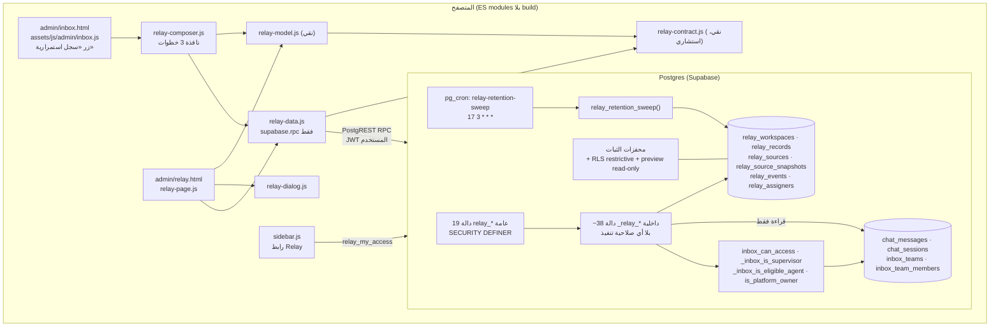
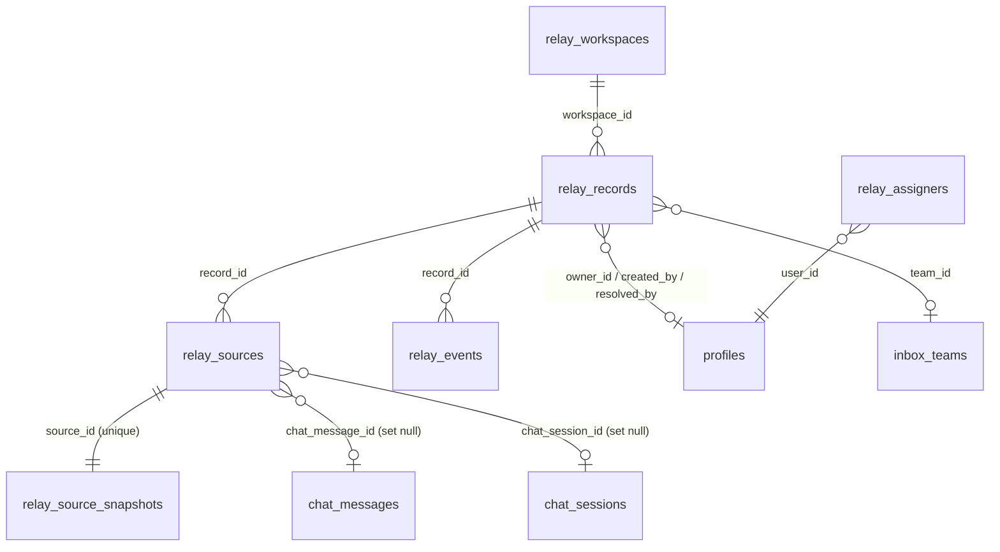
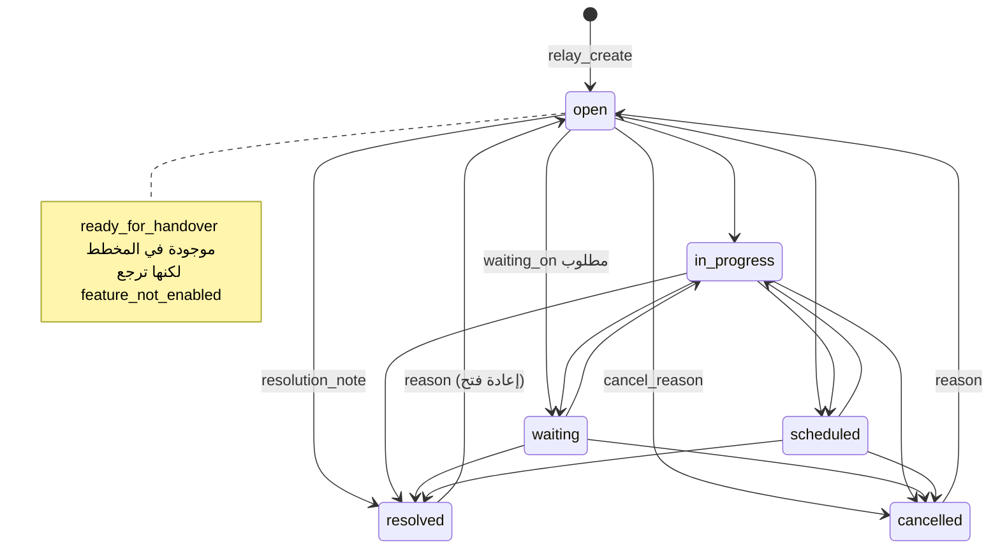

# Mad3oom Relay — المعمارية الحالية (كما هي مبنية ومشغّلة)

> **التاريخ:** 2026-10-12.
> **النطاق:** هذه الوثيقة تصف ما هو **موجود فعلًا** في الكود وفي الإنتاج اليوم. لا تصف الخطة.
> - الخطة الكاملة والقرارات وتاريخها موجودة في `docs/relay/RELAY_ARCHITECTURE_AND_IMPLEMENTATION_PLAN.md`.
> - عند أي تعارض بين الوثيقتين، **الكود والإنتاج هما المرجع**. الأقسام 3 و4 و17 هنا تذكر أين تخالف الخطةُ الواقعَ.
>
> **مصادر الأدلة:**
> - **[repo]**: قراءة `origin/main` عند `b2a45ce` (دمج PR #111).
> - **[prod]**: قراءة فقط من مشروع Supabase `srnelrdpqkcntbgudyto` بتاريخ 2026-10-12، عبر `list_migrations` و`SELECT` فقط.
> - **[test]**: اختبارات شُغّلت محليًا في هذه الجلسة. الأوامر والنتائج في القسم 15.

---

## المحتويات
1. [الخلاصة](#1-الخلاصة)
2. [حالة كل مرحلة](#2-حالة-كل-مرحلة)
3. [ما هو موجود وما هو غير موجود](#3-ما-هو-موجود-وما-هو-غير-موجود)
4. [الصورة العامة للمكونات](#4-الصورة-العامة-للمكونات)
5. [خريطة الملفات](#5-خريطة-الملفات)
6. [نموذج البيانات](#6-نموذج-البيانات)
7. [نموذج الأمان والصلاحيات](#7-نموذج-الأمان-والصلاحيات)
8. [واجهة الـ RPC العامة (19 دالة)](#8-واجهة-الـ-rpc-العامة-19-دالة)
9. [دورة حياة السجل](#9-دورة-حياة-السجل)
10. [المصادر واللقطات والمقتطفات](#10-المصادر-واللقطات-والمقتطفات)
11. [التكرار الآمن والتزامن والمواعيد](#11-التكرار-الآمن-والتزامن-والمواعيد)
12. [سجل التدقيق (الأحداث)](#12-سجل-التدقيق-الأحداث)
13. [المهام الخلفية](#13-المهام-الخلفية)
14. [الواجهة الأمامية](#14-الواجهة-الأمامية)
15. [الاختبارات](#15-الاختبارات)
16. [حالة الإنتاج](#16-حالة-الإنتاج)
17. [الفجوات مقارنة بالمواصفة الرئيسية](#17-الفجوات-مقارنة-بالمواصفة-الرئيسية)
18. [المخاطر المتبقية وقواعد التشغيل](#18-المخاطر-المتبقية-وقواعد-التشغيل)

---

## 1. الخلاصة

Relay اليوم **نواة سجلات استمرارية** تعمل داخل صندوق دعم المنصة (`admin/inbox.html`). الموظف يختار رسائل من محادثة، ويحوّلها إلى سجل من نوع «متابعة بموعد محدد» أو «مشكلة تحتاج حلًا». بعدها يدير السجل من صفحة `admin/relay.html`: يعدّله، ويسنده، ويغيّر حالته، ويدير مصادره، ويرى تاريخه.

المعمارية مبنية على أربعة مبادئ:

1. **كل القواعد في Postgres.** الجداول بلا أي صلاحية مباشرة. كل قراءة وكتابة تمر عبر دوال `SECURITY DEFINER` تتحقق من `auth.uid()` بنفسها.
2. **المقتطف محمي بصلاحية المحادثة، لا بصلاحية السجل** (القرار C3). يُعاد الفحص في كل قراءة، وأي خطأ يُخفي المقتطف.
3. **السجل لا يُحذف أبدًا.** يُلغى بدل الحذف. المحتوى يُحجب ولا تُحذف صفوفه. الأحداث للإلحاق فقط. هذا مفروض بمحفزات تسري حتى على المالك الخارق.
4. **الواجهة استشارية.** الواجهة تخفي وتُظهر الأدوات حسب الصلاحية، لكن الخادم هو صاحب القرار في كل عملية.

**غير موجود حتى الآن** (التفاصيل في القسم 17): التسليم بين الموظفين، والتذكيرات والتصعيد، ومراقب الاستمرارية، والإشعارات، والاستخراج بالذكاء الاصطناعي، وواجهة `relay-api` الخارجية، ومساحات الشركات.

---

## 2. حالة كل مرحلة

الحالات الأربع منفصلة: «منفَّذ» لا يعني «مُختبَر»، و«مُختبَر» لا يعني «منشور».

| المرحلة | المحتوى | منفَّذ | مُختبَر | مطبَّق على الإنتاج | متحقَّق منه في الإنتاج |
|---|---|---|---|---|---|
| B (073) | التخزين الأساسي، الأمان، الاحتفاظ | نعم [repo] | نعم، 31 فحص SQL [test] | نعم، `20261009133459` [prod] | جزئيًا: الكائنات موجودة، الكنس يعمل يوميًا، آخر تشغيل `2026-10-12 03:17 UTC` [prod] |
| C (074) | اختيار الرسائل، معاينة النوع، التصنيف، صلاحية الإسناد P3/P4 | نعم | نعم، 17 فحص SQL + اختبارات العرض | نعم، `20261009152023` | جزئيًا: 19 دالة قابلة للتنفيذ لـ `authenticated` كما هو متوقع |
| 076 | المحذوفات، المسح النهائي للمالك، T1–T3 | نعم | نعم، 14 فحص SQL | نعم، `20261009193924` | جزئيًا: الأعمدة موجودة، لا شيء في المحذوفات حاليًا |
| حوارات داخل الصفحة (PR #110) | بديل `confirm`/`prompt` | نعم | ضمن اختبارات العرض | الواجهة على Vercel من `main` [افتراض: لم أتحقق من النسخة المنشورة] | لا |
| D | التسليم وقبوله | **لا** | — | — | — |
| E | الجدولة، التذكير، التصعيد، المراقب، الإشعارات | **لا** (فقط كنس الاحتفاظ اتنقل لـ B) | — | — | — |
| F | التحقق الشامل والإطلاق | **لا** | — | — | — |
| G | `relay-api` + OAuth scopes | **لا** (يوجد فقط تمهيد `_relay_via_api`) | — | — | — |
| H | إضافة المتصفح | **لا** | — | — | — |

**الخطة متأخرة عن الواقع في ملاحظتين:**
- رأس وثيقة الخطة ما زال يقول إن المرحلة B «غير مطبقة وغير مفعلة».
- تعليق `tests/company-navigation.test.mjs:491` ما زال يقول إن 076 «غير مطبَّق على الإنتاج».

الحقيقة أن الثلاث مطبقة وأن Relay مفعّل (القسم 16).

---

## 3. ما هو موجود وما هو غير موجود

| القدرة | الحالة الحالية |
|---|---|
| اختيار عدة رسائل من محادثة | **موجود** في نافذة من 3 خطوات داخل الصندوق، بحد أقصى 20 رسالة لكل طلب |
| الأنواع الثلاثة | **اثنان فقط**: `follow_up` و`issue`. نوع `handover` وحالة `ready_for_handover` يرجعان `feature_not_enabled` |
| معاينة قابلة للتعديل قبل الإنشاء | **موجودة**. لا شيء يُحفظ قبل الضغط على «إنشاء» |
| استخراج السياق | **حتمي وغير ذكي**: تصنيف بالكلمات المفتاحية، ومواعيد صريحة مكتوبة في الرسائل فقط. العنوان والملخص لا يُملآن من نص الرسائل أبدًا (M5). المالك لا يُقترح أبدًا |
| الإنشاء اليدوي بلا رسائل | **الخادم يدعمه** (`relay_create` بلا `sources`)، لكن **لا يوجد زر له في الواجهة** |
| إرفاق رسائل بسجل موجود | **موجود** في وضع «سجل موجود» داخل النافذة |
| الملكية والإسناد | **موجود** بقواعد P3/P4 وصلاحية إسناد صريحة يمنحها المالك |
| انتقالات الحالة | **موجودة** على الخادم، مع فحص النسخة (`version`) |
| التدقيق | **موجود**: جدول للإلحاق فقط، بلا نصوص حرة |
| المتأخرات | **مشتقة فقط**: حقل `overdue` في الـ JSON. لا يوجد كشف خلفي ولا تنبيه |
| التذكيرات والتصعيد والإشعارات | **غير موجودة** |
| مراقب الاستمرارية | **غير موجود** |
| تسليم الوردية | **غير موجود** |
| عزل المستأجرين | مساحة واحدة فقط (`platform`). عمود `workspace_id` موجود في كل الجداول تمهيدًا للشركات |

---

## 4. الصورة العامة للمكونات



**ثلاث نقاط أساسية في الصورة:**
- Relay **لا يكتب** أبدًا في جداول `chat_*` أو `inbox_*` أو `tickets` أو `profiles`، ولا يضيف عليها أعمدة أو محفزات. هو يقرأها فقط لالتقاط المقتطف وفحص الصلاحية.
- لا توجد Edge Function خاصة بـ Relay. الواجهة تنادي الـ RPC مباشرة بجلسة المستخدم.
- كل منطق الأعمال في الطبقة السفلى (SQL). الطبقة العليا (JS) للعرض والتحقق المبدئي فقط.

---

## 5. خريطة الملفات

| الملف | الأسطر | الدور |
|---|---|---|
| `migrations/073_relay_core.sql` | 1515 | الجداول الخمسة، المحفزات، RLS، المساعدات، 11 RPC، الكنس، جدولة cron، فحوص ختامية |
| `migrations/074_relay_phase_c.sql` | 677 | `category`، `relay_assigners`، P3/P4، 4 RPC جديدة، إعادة تعريف 5 دوال |
| `migrations/076_relay_trash_owner.sql` | 586 | أعمدة المحذوفات، محفز المسح النهائي، 4 RPC جديدة، إعادة تعريف 9 دوال |
| `migrations/_rollback/07{3,4,6}_*.down.sql` | 88 / 380 / 260 | تراجع مُختبَر لكل هجرة. يرفض التشغيل إذا كان سيُضيع بيانات، إلا مع `relay.rollback_discard_data=on` |
| `assets/js/relay/relay-contract.js` | 232 | العقد v1: الحدود، القيم المسموحة، بناء الطلب، التحقق المبدئي، ترجمة الأخطاء، `describeSource` |
| `assets/js/relay/relay-model.js` | 371 | منطق نقي: الفلترة، التحديد، اقتراح التصنيف، كشف المواعيد، الحقول الناقصة، الانتقالات والإسناد المعروضة |
| `assets/js/relay/relay-data.js` | 80 | غلاف RPC فقط، و`loadRelayAccess` |
| `assets/js/relay/relay-composer.js` | 487 | نافذة الإنشاء أو الإرفاق في الصندوق |
| `assets/js/relay/relay-page.js` | 504 | صفحة القائمة والتفاصيل والمحذوفات وصلاحية الإسناد |
| `assets/js/relay/relay-dialog.js` | 69 | `relayConfirm` و`relayPrompt` باستخدام `<dialog>` |
| `assets/js/relay/relay-icons.js` | 30 | أيقونات SVG داخلية |
| `assets/css/relay.css` | 256 | تنسيقات `rl-*`، RTL ومتجاوبة |
| `admin/relay.html` | 81 | هيكل الصفحة |
| تكامل: `assets/js/admin/inbox.js`، `admin/inbox.html`، `assets/js/admin/sidebar.js`، `assets/components/sidebar.html` | — | زر الصندوق، ورابط الشريط الجانبي (يظهر فقط لعضو وRelay مفعّل) |
| `tests/relay-contract.test.mjs`، `tests/relay-model.test.mjs`، `tests/relay-phase-c.render.test.mjs` | 151 / 201 / 774 | اختبارات العقد والمنطق، واختبارات عرض Playwright مع بدائل وهمية لـ Supabase |
| `tests/sql/relay-core.test.sql`، `relay-phase-c.test.sql`، `relay-trash-owner.test.sql` | 1273 / 812 / 702 | اختبارات على Postgres حقيقي فوق نسخة بشكل الإنتاج (`tests/fixtures/prod-shape`) |
| `docs/relay/*` | — | الخطة، ومذكرات التثبيت لكل مرحلة، وهذه الوثيقة |

---

## 6. نموذج البيانات

### 6.1 العلاقات



### 6.2 `relay_workspaces` (073)

| العمود | ملاحظات |
|---|---|
| `id`, `kind` (`platform`\|`company`), `company_id` | قيد: `company_id` موجود إذا وفقط إذا كان `kind = 'company'`. يوجد فهرس فريد يسمح بصف `platform` واحد فقط |
| `enabled boolean default false` | **مفتاح الإيقاف.** كل RPC عامة ترجع `0A000 feature_not_enabled` وهو مطفأ. استثناءان يعملان دائمًا: الكنس و`relay_redact_for_subject` |
| `default_timezone` | `Africa/Cairo`. لا يُستخدم في الخادم حاليًا |
| `snapshot_retention_days` | قيد `CHECK (= 365)`. تغييره يحتاج هجرة جديدة (C5) |

يوجد اليوم صف واحد فقط: `platform`. أي `workspace_id` يرسله العميل غير `platform` أو معرّف صف المنصة يُرفض (C1).

### 6.3 `relay_records` (073 + `category` من 074)

| مجموعة | الأعمدة |
|---|---|
| الهوية | `id`, `workspace_id`, `kind` (`follow_up`\|`issue`\|`handover`), `category` (9 قيم ثابتة أو null) |
| المحتوى (نص حر) | `title` (1–160)، `summary` (≤4000)، `next_action` (≤1000)، `problem`، `known_facts`، `unknowns`، `resolution_criteria` (≤4000 لكل واحد) |
| الحالة | `status` (7 قيم)، `waiting_on`، `priority` (1–4، الافتراضي 3) |
| الملكية | `owner_id` (null تعني بلا مالك)، `team_id` → `inbox_teams` |
| الموعد | `due_at timestamptz`، `due_tz` (اسم IANA). القيد: يوجدان معًا أو يغيبان معًا |
| الإغلاق | `resolution_note`, `resolved_at`, `resolved_by`, `cancel_reason`, `closed_at` |
| الإنشاء والتزامن | `created_by`, `created_at`, `updated_at`, `version` (≥1), `created_via` (`native`\|`extension`\|`integration`\|`system`) |
| التكرار الآمن | `idempotency_key uuid not null`, `request_hash`، و`UNIQUE (created_by, idempotency_key)` |

**القيود (CHECK):**
- `closed_at` موجود إذا وفقط إذا كانت الحالة `resolved` أو `cancelled`.
- `resolved` تتطلب `resolution_note` و`resolved_at`.
- `cancelled` تتطلب `cancel_reason`.
- متابعة نشطة (`follow_up`) تتطلب `due_at`.
- `category` من القائمة المغلقة.

**الفهارس:**
- `(workspace_id, status, owner_id)`.
- `due_at` و`team_id` للسجلات النشطة فقط.
- `created_by`.
- `closed_at` حيث لا يكون null.

### 6.4 `relay_sources` (073 + أعمدة المحذوفات من 076)

| العمود | ملاحظات |
|---|---|
| `record_id`, `workspace_id` (منسوخ من السجل), `position` | `UNIQUE (record_id, position)` |
| `source_type`, `provider`, `adapter`, `adapter_version` | المخطط يقبل 9 أنواع، **لكن الخادم يقبل اليوم `mad3oom_message` فقط** (`mad3oom` / `mad3oom-inbox`) |
| `chat_message_id`, `chat_session_id`, `ticket_id` | FK مع `on delete set null` |
| `url_*`, `page_title`, `external_*`, `provider_ids` | للمحولات المستقبلية. فارغة اليوم |
| `captured_at`, `captured_by`, `capture_client` | |
| `dedupe_key` | `mad3oom_message:mad3oom:<message id>`، و`UNIQUE (record_id, dedupe_key)` |
| `access_state`, `access_checked_at` | للمستقبل. لا يغيّرهما أي كود اليوم |
| `removed_at`/`removed_by` (076) | المصدر في «المحذوفات»، وقابل للاسترجاع |
| `purged_at`/`purged_by` (076) | ممسوح نهائيًا. قيد: `purged` يتطلب `removed` |

### 6.5 `relay_source_snapshots` (073)

| العمود | ملاحظات |
|---|---|
| `source_id` (unique), `record_id`, `workspace_id` | |
| `origin_session_id`, `origin_customer_id` | **بلا FK عمدًا**: يبقى تقييم الصلاحية (C3) وطلبات الحذف (M8) ممكنًا حتى لو صار الـ FK في `relay_sources` يساوي null |
| `excerpt` (≤4000) | نص الرسالة كما التُقط، **ينسخه الخادم من قاعدة البيانات**، لا من العميل |
| `excerpt_sha256` | لا تُرجعه أي دالة أبدًا (M4) |
| `sender_label` | فقط `العميل` أو `الدعم` أو `البوت`. لا أسماء ولا أرقام |
| `original_created_at`, `truncated` | |
| `source_deleted_at` | العمود موجود (C4)، **لكن لا شيء يكتب فيه حاليًا**. الختم كان مخططًا للمرحلة E. الحذف يُشتق في وقت القراءة |
| `redacted_at`, `redacted_by`, `redaction_reason` (`retention`\|`manual`\|`data_subject_request`) | قيود: الحجب يمسح `excerpt` و`sender_label`، والصف غير المحجوب يجب أن يحمل نصًا |

### 6.6 `relay_events` (073)
- الأعمدة: `id bigint identity`, `record_id`, `workspace_id`, `actor_id` (null يعني النظام), `client` (`native`\|`extension`\|`integration`\|`cron`), `kind`, `payload jsonb`, `created_at`.
- فهرس: `(record_id, id desc)`.
- القواعد الكاملة للأحداث في القسم 12.

### 6.7 `relay_assigners` (074)
- الأعمدة: `user_id`, `granted_by/at`, `revoked_by/at`.
- فهرس فريد يسمح بمنح نشط واحد لكل مستخدم.
- السحب يملأ `revoked_at` فقط. الصف يبقى للتاريخ.
- محفز يمنع تعديل المنح أو التراجع عن السحب. لا `TRUNCATE`.

### 6.8 محفزات الثبات (تسري على المالك الخارق أيضًا)

| المحفز | ما يمنعه |
|---|---|
| `trg_relay_record_no_delete` + `no_truncate` | حذف أي سجل. الطريق الوحيد هو الإلغاء |
| `trg_relay_events_append_only` + `no_truncate` | أي `UPDATE` أو `DELETE` على الأحداث |
| `trg_relay_source_guard` | حذف مرجع، أو تغيير هويته. المسموح فقط: `set null` من الـ FK، وأعمدة الوصول والمحذوفات |
| `trg_relay_source_trash_guard` (076) | أي تعديل على مصدر بعد مسحه نهائيًا (لا استرجاع) |
| `trg_relay_snapshot_guard` + `no_truncate` | حذف لقطة، أو تعديل هويتها أو نصها. المسموح فقط: الحجب، وختم `source_deleted_at` مرة واحدة. **الحجب نهائي** (M10) |
| `trg_relay_assigner_guard` + `no_truncate` | تعديل منح، أو التراجع عن سحبه |
| `trg_preview_read_only` (اتفاقية 041) | أي كتابة أثناء وضع المعاينة |

---

## 7. نموذج الأمان والصلاحيات

### 7.1 طبقات الحماية

1. **لا صلاحيات على الجداول.**
   - `revoke all` من `public` و`anon` و`authenticated`، **ومن `service_role` أيضًا**، على كل الجداول الستة والتسلسل.
   - RLS مفعّل، و**بلا أي سياسة سماح**.
   - توجد فقط السياسة المقيِّدة `gate_account_active` (اتفاقية 042).
2. **الدوال.** الـ 19 RPC العامة:
   - `SECURITY DEFINER` مع `search_path = public` ثابت.
   - `grant execute` لـ `authenticated` فقط.
   - كل الدوال الداخلية `_relay_*` مسحوبة من كل الأدوار.
   - كل هجرة تنتهي بكتلة تحقق **تُفشل الهجرة كلها** إذا وُجدت سياسة سماح، أو صلاحية مباشرة على جدول، أو دالة مكشوفة لدور غير مقصود، أو دالة definer بلا `search_path`.
3. **كل RPC تتحقق بنفسها.** الترتيب في كل دالة:
   - `_relay_require_member()`.
   - ثم `_relay_workspace()` (مفتاح الإيقاف + C1).
   - ثم `relay_can_access(record)`.
   - ثم قاعدة الصلاحية الخاصة بالعملية.
   - ثم فحص النسخة.
4. **فشل مغلق.** عند الشك يكون الرد الأقل صلاحية:
   - `not_found` يُستخدم لـ«غير موجود» ولـ«غير مسموح برؤيته» معًا، حتى لا يُستنتج وجود السجل.
   - أي استثناء أثناء فحص المقتطف يعني أن المقتطف مخفي.

### 7.2 الأدوار كما تحسبها الدوال

| الدور | الدالة | التعريف الفعلي |
|---|---|---|
| عضو | `_relay_is_member()` | `auth.uid()` موجود، والحساب نشط (`account_is_active`)، وليس في وضع المعاينة، و(`is_platform_staff()` أو مشرف) |
| مشرف | `_relay_is_supervisor()` | `_inbox_is_supervisor()` (مدير بصلاحية عليا، أو المالك في سياق الإدارة)، **وليس** عبر الـ API |
| مالك المنصة | `_relay_is_owner()` (076) | عضو، و`is_platform_owner()`، وليس عبر الـ API. لا يقرأ بريدًا ولا اسمًا |
| صاحب صلاحية الإسناد | `_relay_can_assign()` (074) | عضو، و(مشرف أو منح نشط في `relay_assigners` لموظف مؤهل حاليًا) |
| مالك مؤهل (هدف) | `_relay_is_eligible_owner(user)` | نفس مجموعة `inbox_list_agents`، والحساب نشط وغير محظور. **يُقيَّم للمستخدم المستهدف، لا للمتصل** |
| عبر الـ API | `_relay_via_api()` | `request.jwt.claims.relay_client <> 'native'`. أي claims غير مقروءة، أو غائبة مع وجود مستخدم، تُعامَل كأنها API (الأقل صلاحية). **لا يوجد مسار API اليوم**؛ هذا تمهيد للمرحلة G |

### 7.3 من يرى السجل؟ `relay_can_access(record)`

يرى السجل العضو الذي يحقق شرطًا واحدًا على الأقل مما يلي، بشرط أن تكون مساحة المنصة مفعّلة:
- مشرف،
- أو مالك السجل،
- أو منشئ السجل،
- أو عضو في فريق السجل، والفريق غير مؤرشف.

المالك السابق يفقد الوصول بعد إعادة الإسناد، إلا إذا انطبق عليه شرط آخر (M9). في هذه الحالة يرجع `relay_assign` القيمة `access: 'lost'`.

### 7.4 من يرى المقتطف؟ (C3 المعدَّل / M11)

صلاحية السجل **لا تكفي** لرؤية المقتطف. الدالة `_relay_source_view` تُقيَّم **لكل مصدر في كل قراءة**، بلا أي تخزين مؤقت:

```
relay_can_access(record)?                     لا ⇒ hidden: no_conversation_access
provider = 'mad3oom'?                         لا ⇒ hidden: no_provider_rule
لقطة موجودة ومطابقة للسجل والمساحة؟           لا ⇒ hidden
_relay_can_read_conversation(origin_session)  لا ⇒ hidden
   ├─ الجلسة لازم تكون موجودة (يسد U9: inbox_can_access يقبل أي معرّف للمشرف)
   ├─ native: inbox_can_access(session)
   └─ API:    is_platform_staff() و _inbox_is_assigned(uid, session) فقط
محجوب؟                                        نعم ⇒ excerpt=null + redacted{at,by,reason}
انتهى الاحتفاظ (closed_at + 8760 ساعة)؟         نعم ⇒ excerpt=null + retention_expired (M6)
وإلا ⇒ excerpt + sender_label + original_created_at + truncated
        + source_deleted / source_deleted_at (مشتقة من chat_messages.deleted_at أو FK = null)
        + edited_after_capture (sha256 للنص الحي ≠ بصمة اللقطة)
أي استثناء ⇒ hidden
```

- رمز واحد، `no_conversation_access`، يغطي: لا صلاحية، والجلسة محذوفة، و`origin_session_id` يساوي null، والفحص فشل. الهدف ألا يستطيع أحد التمييز بين «المحادثة محذوفة» و«ليس لك صلاحية عليها».
- **المقتطف والمرسل والبصمة تظهر فقط في:**
  - `relay_get` وكل RPC ترجع `_relay_full`،
  - و`relay_list_removed`.
- **ولا تظهر أبدًا في:** `relay_list`، و`relay_find_by_source`، و`relay_events_for`، ولا في أي حدث (M4).

### 7.5 قواعد الكتابة (P1–P4، T1–T3)

| العملية | من يُسمح له |
|---|---|
| تعديل الحقول (`relay_update`) — **P1** | كل من يرى السجل، على سجل غير مقفول |
| إرفاق رسائل (`relay_attach_sources`) — **P2** | كل من يرى السجل، **مع** صلاحية حالية على محادثة كل رسالة |
| إنشاء سجل لغيرك أو لفريق — **P3** | أصحاب صلاحية الإسناد فقط. غيرهم: المالك = نفسه أو بلا مالك، وبلا فريق. الرفض (`42501 field=owner_id\|team_id`) يحدث **قبل** فحص أهلية الهدف، حتى لا يُكشف شيء عن المستهدف |
| إعادة الإسناد — **P4** | صاحب صلاحية الإسناد: أي مالك مؤهل وأي فريق. المالك الحالي بلا صلاحية: لنفسه أو بلا مالك فقط، ولا يغيّر الفريق. سجل بلا مالك: تأخذه لنفسك فقط، والفريق كما هو. الشرط كله داخل `coalesce(…, false)` لسد ثغرة U18 |
| انتقال الحالة | المالك أو المشرف |
| نقل مصدر إلى المحذوفات واسترجاعه — **T1** | كل من يرى السجل، على سجل غير مقفول، وبالنسخة الحالية |
| مسح نهائي (`relay_redact_source(…,'manual')`، `relay_purge_removed`) — **T2** | **مالك المنصة فقط**، ويُسمح حتى على سجل مقفول |
| حجب لطلب حذف بيانات (M8) | **المشرف فقط**، من المسار الأصلي. يحجب المقتطف ولا يُخفي المصدر |
| منح صلاحية الإسناد وسحبها وعرضها — **T3** | **مالك المنصة فقط** (قبل 076 كانت للمشرف) |

### 7.6 فحص البيانات الحساسة (M1)
- **ما يكشفه:** `_relay_sensitive_kinds` يبحث عن أربع فئات: رقم قومي مصري (14 رقمًا تبدأ بـ 2 أو 3)، ورقم بطاقة (13–19 رقمًا)، وكود تحقق بعد كلمة دالّة، وكلمة سر بعد «:» أو «=» أو «هي». يحوّل الأرقام العربية والفارسية أولًا، وهذا آمن بأي ترميز للقاعدة.
- **متى يُرفض الطلب:** إذا وُجدت أي فئة في الرسائل المختارة، يُرفض الإنشاء أو الإرفاق بـ `22023 sensitive_content` ومعه قائمة الفئات، إلا إذا أُرسل `sensitive_ack: true`.
- **ما يُسجَّل:** الحدث `sensitive_ack` يحمل العلم فقط، بلا الفئة.
- **نسخة الواجهة:** نسخة مماثلة في `relay-contract.js` تنبّه المستخدم مبكرًا. هي استشارية فقط.

---

## 8. واجهة الـ RPC العامة (19 دالة)

كل الدوال لـ `authenticated` فقط. كل دالة كتابة تعمل في معاملة واحدة، فلا يوجد نجاح جزئي.

| # | الدالة | من | يقرأ/يكتب | الرد |
|---|---|---|---|---|
| 1 | `relay_my_access()` | أي مستخدم مسجّل الدخول (لا ترفض) | — | `{member, enabled, supervisor, can_assign, owner}`. للواجهة فقط |
| 2 | `relay_create(p_request jsonb)` | عضو. P3 | سجل + مصادر + لقطات + أحداث | `{record, sources, removed, replayed}` |
| 3 | `relay_get(p_record)` | من يرى السجل | — | `_relay_full` |
| 4 | `relay_list(p_filters)` | عضو | — | مصفوفة بلا مقتطفات، مع `source_count` لغير المحذوفة. الفلاتر: `status[]`، `kind`، `category`، `owner` (`me`\|`unassigned`\|uuid)، `limit` (≤100)، ومؤشر صفحات `before`/`before_id` |
| 5 | `relay_update(id, patch, version)` | P1 | الحقول النصية، `priority`، `category`، `due` | `_relay_full` |
| 6 | `relay_assign(id, owner, team, version)` | P4 | `owner_id`, `team_id` | `_relay_full`، أو `{record:{id,version}, access:'lost'}` |
| 7 | `relay_transition(id, to, details, version)` | المالك أو المشرف | الحالة وحقول الإغلاق | `_relay_full` |
| 8 | `relay_attach_sources(id, sources, version, ack)` | P2 | مصادر جديدة، أو استرجاع مصادر من المحذوفات | `_relay_full + {added, restored}` |
| 9 | `relay_remove_source(source, version)` | T1 | `removed_at` | `_relay_full` |
| 10 | `relay_restore_source(source, version)` | T1 | `removed_at = null` | `_relay_full` |
| 11 | `relay_list_removed(limit)` | عضو | — | المحذوفات عبر كل السجلات المرئية (≤200)، والمقتطف حسب C3 |
| 12 | `relay_redact_source(source, reason)` | `manual`: المالك (T2). `data_subject_request`: المشرف | حجب، ومع `manual` أيضًا `purged` | `_relay_full` |
| 13 | `relay_purge_removed(record?)` | المالك | مسح كل المحذوفات لسجل واحد أو لكل السجلات | `{purged: n}` |
| 14 | `relay_redact_for_subject(user, reason)` | مشرف، مسار أصلي. **تعمل حتى وRelay مطفأ** | حجب كل لقطات محادثات عميل | عدد اللقطات المحجوبة |
| 15 | `relay_find_by_source(source)` | عضو **مع** صلاحية على المحادثة، وإلا `[]` | — | `[{id, kind, title, status}]`. تتجاهل المحذوف |
| 16 | `relay_events_for(record, before, limit)` | من يرى السجل | — | الأحداث، الأحدث أولًا (≤200). سبب `data_subject_request` يظهر `not_shown` لغير المشرف |
| 17 | `relay_list_assigners()` | المالك | — | المنح النشطة مع الاسم والبريد والأهلية |
| 18 | `relay_grant_assigner(user)` | المالك | صف منح. الهدف لازم يكون مؤهلًا. المنح المكرر لا يفعل شيئًا | `{granted, changed}` |
| 19 | `relay_revoke_assigner(user)` | المالك | `revoked_at` | `{granted:false, changed}` |

**دالة غير متاحة لأي دور:** `relay_retention_sweep(p_limit)`. يستدعيها `pg_cron` فقط (القسم 13).

### 8.1 طلب الإنشاء (العقد v1)

```json
{
  "contract_version": 1,
  "idempotency_key": "uuid",
  "kind": "follow_up | issue",
  "category": "order_status | … | other | null",
  "title": "…", "summary": "…", "next_action": "…",
  "priority": 1,
  "owner_id": "uuid | null", "team_id": "uuid | null",
  "due": { "at": "2026-10-13T10:00:00", "tz": "Africa/Cairo" },
  "issue": { "problem": "…", "known_facts": "…", "unknowns": "…", "resolution_criteria": "…" },
  "sources": [ { "type": "mad3oom_message", "provider": "mad3oom", "adapter": "mad3oom-inbox",
                 "adapter_version": "1", "internal": { "chat_message_id": "uuid" } } ],
  "sensitive_ack": true
}
```

**قواعد التحقق على الخادم:**
- **الحجم والعقد:** الطلب ≤ 64KB، و`contract_version = 1`.
- **أنواع الحقول:** الحقول النصية لازم تكون نصوصًا فعلًا، ولا تحويل صامت لأرقام أو كائنات.
- **المتابعة (`follow_up`):** تتطلب `next_action` و`due`.
- **المشكلة (`issue`):** تتطلب `issue.problem`، أو `summary` كبديل.
- **حدود المصادر:** ≤ 20 مصدرًا في الطلب، و≤ 100 مصدر في السجل.
- **من يصف الرسالة:** العميل يرسل **معرّف الرسالة فقط**. الخادم يتحقق أن الرسالة موجودة، ولها نص، وغير محذوفة، وأن المتصل يقرأ محادثتها الآن، وأن العميل صاحب المحادثة ليس عليه طلب حذف بيانات (`subject_redacted`). بعدها **الخادم وحده** ينسخ النص ويحدد المرسل.

### 8.2 خريطة الأخطاء (الخادم ⇒ الواجهة)

| SQLSTATE | الرمز | أمثلة السبب |
|---|---|---|
| `22023` | `validation_failed` + `{field, reason, kinds?}` | `next_action_and_due_required`، `dst_gap`، `in_past`، `too_far`، `not_eligible`، `sensitive_content`، `message_has_no_text`، `subject_redacted`، `too_many` |
| `P0002` | `not_found` | غير موجود أو غير مرئي، أو رسالة لا تقرأ محادثتها |
| `42501` | `forbidden` + `{field}` | `owner_id`، `team_id`، `owner`، `supervisor` |
| `40001` | `version_conflict` + `current_version` | نسخة قديمة |
| `23505` | `idempotency_conflict` | نفس المفتاح مع طلب مختلف |
| `55000` | `invalid_transition` | سجل مقفول، أو انتقال غير مسموح |
| `0A000` | `feature_not_enabled` | Relay مطفأ، أو handover، أو نوع مصدر غير مفعّل، أو مساحة غير المنصة |

`mapRelayError` يحوّل هذه الأخطاء إلى رسائل عربية ثابتة، **ولا يعرض نص الخادم كما هو**.

---

## 9. دورة حياة السجل



- **الحالات النشطة:** `open` و`scheduled` و`in_progress` و`waiting`. الانتقال مسموح بين أي اثنتين منها. `waiting` يتطلب `waiting_on`، وأي حالة غيرها تمسحه.
- **الإغلاق:** `resolved` أو `cancelled`.
  - يملأ `closed_at`، وهذا يبدأ ساعة الاحتفاظ (C5).
  - السجل المقفول لا يُعدَّل، ولا يُسند، ولا تُرفق به مصادر، ولا تُزال منه. الاستثناء الوحيد: المسح النهائي للمالك والحجب لطلب حذف بيانات.
- **إعادة الفتح:**
  - تمسح `closed_at` وحقول الإغلاق.
  - **إذا كان الاحتفاظ انتهى والكنس لم يعمل بعد**، تُحجب مقتطفات السجل فورًا بسبب `retention`، وإلا كانت إعادة الفتح ستُرجع محتوى منتهي الصلاحية.
- **`overdue` مشتق فقط.** يُحسب في الـ JSON كالتالي: الحالة نشطة، و`due_at < now()`. لا شيء يتغير عند مرور الموعد، ولا يُغلق أي سجل تلقائيًا.
- **الواجهة تعرض انتقالات أقل من الخادم.** `allowedTransitions` في الواجهة لا تعرض الانتقال إلى `scheduled`، رغم أن الخادم يسمح به.

---

## 10. المصادر واللقطات والمقتطفات

### 10.1 مسار الالتقاط (`_relay_attach`)

1. لكل عنصر: النوع لازم يكون `mad3oom_message`، وإلا يُرفض بـ `0A000`.
2. قراءة الرسالة والجلسة. إذا لم توجد، أو لم يستطع المتصل قراءة المحادثة، يُرفض بـ `P0002`. الرد واحد في الحالتين، فلا يُستنتج وجود الرسالة.
3. يُرفض إذا كانت الرسالة محذوفة أو بلا نص، أو إذا كان على العميل طلب حذف بيانات.
4. **إزالة التكرار:** إذا كان `dedupe_key` موجودًا في السجل، يُتخطى العنصر. لا يُعاد التقاط مقتطف محجوب، ولا يُعاد التقاط مصدر ممسوح.
5. **حساب المرسل:** `البوت` إذا كانت `is_bot_reply`، و`الدعم` إذا كانت `is_admin_reply` أو كان المرسل غير صاحب الجلسة، وإلا `العميل`.
6. إدراج المرجع واللقطة، وأول 4000 حرف من النص مع بصمتها، وحدث `source_attached` **بلا نص**.
7. **فحص M1 في النهاية:** إذا وُجدت فئة حساسة بلا `ack`، يُرفض الطلب. المعاملة كلها تُلغى، فلا يبقى سجل ناقص.

### 10.2 أشكال المصدر عند القراءة

| الحالة | ما يرجع | ما تعرضه الواجهة (`describeSource`) |
|---|---|---|
| مرئي | `excerpt`، `sender_label`، `original_created_at`، `truncated`، `source_deleted(_at)`، `edited_after_capture`، `chat_session_id`، `chat_message_id` | النص، مع رابط «فتح المحادثة» إلى `/admin/inbox.html?session=…` |
| بلا صلاحية على المحادثة | `excerpt_hidden: no_conversation_access` | «محتوى من محادثة لا تملك صلاحية الوصول إليها» |
| مزوّد بلا قاعدة | `no_provider_rule` | «محتوى من مصدر غير مدعوم بعد» |
| محجوب | `redacted {at, by, reason}` | «تم حذف المحتوى» |
| انتهى الاحتفاظ | `retention_expired: true` | «انتهت مدة الاحتفاظ بالمحتوى» |

### 10.3 الإزالة والحجب والمسح: ثلاثة مفاهيم مختلفة

| المفهوم | الأثر | يمكن التراجع؟ | من |
|---|---|---|---|
| **إزالة** (المحذوفات، 076) | `removed_at`. المصدر يختفي من `sources` ويظهر في `removed`، والمقتطف لا يُمس. لا يُحسب في `source_count` ولا في `find_by_source` | نعم: `relay_restore_source`، أو بإعادة إرفاق نفس الرسالة | كل من يرى السجل |
| **حجب** | `excerpt = null` و`sender_label = null`، مع بقاء المرجع والبصمة والأحداث | **لا** (M10) | النظام (`retention`)، أو المشرف (`data_subject_request`) |
| **مسح نهائي** (076) | حجب، ثم `removed`، ثم `purged`. يختفي من كل مكان، ويبقى الحدث بلا نص. مفتاح التكرار يمنع إعادة التقاطه **لنفس السجل** | **لا**، والمحفز يمنعه حتى للمالك الخارق | **مالك المنصة** |

### 10.4 الاحتفاظ (C5)
- **المدة:** 365 × 24 = **8760 ساعة بالضبط** من `closed_at`. الحساب بالساعات لا بالأيام التقويمية، حتى لا تؤثر منطقة الجلسة أو التوقيت الصيفي.
- **قناع القراءة (M6):** يُخفي المقتطف فور انتهاء المدة، حتى لو لم يعمل الكنس.
- **الكنس (M7):** يحجب فعليًا من التخزين. التفاصيل في القسم 13.
- **السجلات النشطة لا تنتهي أبدًا.** المقتطفات في المحذوفات تخضع للاحتفاظ مثل غيرها.
- **النسخ الاحتياطية** خارج نطاق هذا الضمان.

### 10.5 طلب حذف بيانات عميل (M8)
- **الأمر:** `relay_redact_for_subject(customer)`.
- **ما يحجبه:** كل لقطة لم تُحجب بعد، و`origin_customer_id` فيها يساوي العميل، أو جلستها من جلساته الحالية.
- **ما يحدث بعده:** يُرفض أي التقاط جديد من محادثات هذا العميل.
- **جلسات الضيوف** (بلا `user_id`): تُحجب مصدرًا مصدرًا بـ `relay_redact_source(id, 'data_subject_request')`.

---

## 11. التكرار الآمن والتزامن والمواعيد

### 11.1 التكرار الآمن (`relay_create`)
1. `request_hash` = sha256 لنص `p_request` بعد حذف `idempotency_key`. الـ `jsonb` يرتّب المفاتيح، فالترتيب لا يؤثر.
2. إذا وُجد سجل بنفس `(created_by, idempotency_key)`:
   - نفس البصمة ⇒ يُرجع **حالته الحالية** مع `replayed: true`.
   - بصمة مختلفة ⇒ `idempotency_conflict`.
3. الإدراج يتم بـ `insert … on conflict (created_by, idempotency_key) do nothing`. إذا لم يُدرج صف (طلب متزامن سبقه)، يُعاد القراءة والمقارنة. النتيجة: لا يصل `23505` خام للعميل أبدًا.
4. **في الواجهة:** نفس محتوى المسودة يعيد استخدام نفس المفتاح بعد فشل الشبكة. أي تعديل في المسودة يولّد مفتاحًا جديدًا (`st.attempt.fingerprint`).

### 11.2 التزامن المتفائل
- كل كتابة على سجل قائم تمر عبر `_relay_lock_for_write(id, expected_version)`، وتعمل كالتالي:
  1. فحص الوصول.
  2. `SELECT … FOR UPDATE`.
  3. مقارنة النسخة. إذا اختلفت: `40001 version_conflict` مع `current_version`.
- كل تغيير يزيد `version` ويحدّث `updated_at`.

### 11.3 المواعيد والمناطق الزمنية
- **الصيغة:** `due.at` **وقت محلي** بالصيغة الثابتة `YYYY-MM-DD[T ]HH:MM[:SS]`. أي إزاحة صريحة مرفوضة، لأنها كانت ستُتجاهل بصمت.
- **المنطقة:** `due.tz` لازم يكون موجودًا في `pg_timezone_names`.
- **التحويل** (`_relay_local_to_utc`):
  - وقت غير موجود بسبب قفزة التوقيت الصيفي ⇒ `dst_gap`.
  - وقت ملتبس عند الرجوع ⇒ اللحظة **الأبكر**.
- **الحدود:** ليس أبعد من 365 يومًا، وليس في الماضي بأكثر من 5 دقائق. حد الماضي يسري عند الإنشاء وعند تعديل `due`.
- **التخزين:** `timestamptz`، ومعه `due_tz` حتى يُعرض الموعد في منطقته الأصلية.
- **كشف المواعيد في الواجهة** (`detectDueCandidates`):
  - يقرأ فقط تواريخ وأوقاتًا مكتوبة صراحةً، بالعربية أو الإنجليزية، مثل «بكرة» و«الساعة 10» و`10/10` وأيام الأسبوع.
  - التاريخ يُحسب نسبةً ليوم الرسالة نفسها، في المنطقة المختارة.
  - إذا غاب الوقت، يُعلَّم ذلك ويُقترح 09:00.
  - المواعيد الماضية تُعرض لكن لا يمكن اختيارها.

---

## 12. سجل التدقيق (الأحداث)

| `kind` | المصدر | الـ payload (بلا نص حر أبدًا) |
|---|---|---|
| `created` | create | `kind`، `status`، `priority`، `category`، `owner_id`، `team_id`، `due_at`، `due_tz`، `fields{title…: sha256}` |
| `updated` | update | `changed[]`، `fields{…: sha256}`، `priority{from,to}`، `category{from,to}`، `due{from,to,tz}` |
| `assigned` | assign | `from_owner`، `to_owner`، `from_team`، `to_team` |
| `transitioned` / `resolved` / `cancelled` / `reopened` | transition | `from`، `to` أو `closed_at`، و`fields{waiting_on\|resolution_note\|cancel_reason\|reason: sha256}` |
| `source_attached` | attach | `source_id`، `source_type`، `provider`، `position` |
| `sensitive_ack` | attach | `{sensitive_ack: true}` فقط |
| `source_removed` / `source_restored` | 076 | `source_id`، `position` |
| `source_redacted` | redact، purge، sweep، reopen | `source_id`، `reason`، و`purged: true` أو `trigger: 'reopen'` عند الحاجة |
| `retention_redaction_failed` | sweep | `source_id`، `sqlstate` |

**قواعد عامة للأحداث:**
- `actor_id` يساوي null للنظام.
- `client` يكون `native` أو `cron`. قيمة `extension` محجوزة للمرحلة G.
- **فجوة صغيرة:** `EVENT_LABELS` في الواجهة يعرّف `source_purged`، لكن الخادم لا يصدر هذا النوع. المسح يظهر كحدث `source_redacted` مع `purged: true`.

---

## 13. المهام الخلفية

| المهمة | الجدولة | ماذا تفعل |
|---|---|---|
| `relay-retention-sweep` ⇒ `relay_retention_sweep(5000)` | `pg_cron`، يوميًا `17 3 * * *` UTC، كـ `postgres` | تحجب لقطات السجلات المقفولة التي تجاوزت 8760 ساعة. تحديث فقط على `relay_source_snapshots`. صفًا صفًا مع كتلة استثناء لكل صف. `FOR UPDATE … SKIP LOCKED` على اللقطة والسجل حتى لا تسبق إعادة فتح متزامنة. حدث لكل حجب، وحدث `retention_redaction_failed` عند الفشل. آمنة للتكرار |

**لا توجد أي مهمة أخرى.** لا جدول `relay_jobs`، ولا `relay_tick`، ولا تذكيرات، ولا كشف تأخر، ولا تصعيد، ولا ختم `source_deleted_at`، ولا إشعار M3.

**وضع القاعدة بلا `pg_cron`** (مثل بيئة الاختبار المحلية): الدالة موجودة لكن الجدولة غير مسجّلة.

---

## 14. الواجهة الأمامية

### 14.1 الطبقات

```
relay-contract.js   نقي: العقد، الحدود، buildCreateRequest، validateCreateRequest، mapRelayError، describeSource
      ▲
relay-model.js      نقي: CATEGORY_META، suggestCategory، detectDueCandidates، missingFields،
                    ownerOptions، allowedTransitions، assignmentOptions، EVENT_LABELS
      ▲
relay-data.js       supabase.rpc فقط (باستثناء قراءة inbox_teams للأسماء)، وRelayError
      ▲
relay-composer.js / relay-page.js / relay-dialog.js    DOM
```

- لا إطار عمل ولا bundler. ES modules تُخدم كما هي من Vercel.
- كل نص يدخل الـ DOM يمر عبر `esc()`.
- لا شيء من محتوى Relay يُخزَّن في `localStorage`.

### 14.2 بوابة الظهور
- **`loadRelayAccess()`** تستدعي `relay_my_access`.
  - أي خطأ ⇒ كل الصلاحيات `false`. يحدث هذا مثلًا على قاعدة قبل 074.
  - `trash` = هل في الرد مفتاح `owner`، أي هل 076 مطبَّق. قبله تعمل الصفحة بقواعد 074.
- **زر «سجل استمرارية»** في الصندوق يظهر فقط إذا كان `member && enabled`.
- **رابط Relay** في الشريط الجانبي (`sidebar.js:379`) بنفس الشرط.

### 14.3 نافذة الإنشاء (`openRelayComposer`)

| الخطوة | المحتوى |
|---|---|
| 1. اختيار الرسائل (المرجع A) | بحث مطبَّع للعربية، وفلاتر الوقت والمشارك والنوع، وتحديد متعدد بحد 20، وشريط المختار مع إلغاء كل رسالة. الرسائل المحذوفة والمرفقات بلا نص غير قابلة للاختيار |
| 2. معاينة النوع (المرجع B) | الرسائل المختارة، والتصنيف المقترح مع شارة «موصى به» وزر «ليه؟» يعرض الكلمات المطابقة، وشبكة التصنيفات التسعة، وملاحظة اختيارية |
| 3. التفاصيل | الوضع: «سجل جديد» أو «سجل موجود». في السجل الجديد: النوع (متابعة أو مشكلة)، والعنوان (فارغ مع مثال توضيحي، M5)، والملخص (يبدأ بالملاحظة)، والخطوة التالية، والأولوية، والموعد مع اقتراحات صريحة والمنطقة، والمالك (بلا صلاحية إسناد: «أنا» أو «بدون مالك»، والفريق مخفي)، ولوحة الحقول الناقصة، وتأكيد البيانات الحساسة. زر الإنشاء معطّل أثناء الإرسال |

بعد النجاح يظهر toast فيه رابط `/admin/relay.html?record=<id>`. الرابط لا يظهر إذا رجع `access: 'lost'`.

### 14.4 صفحة `admin/relay.html`
- **القائمة:**
  - فلاتر الحالة: نشطة أو مقفولة أو الكل.
  - فلاتر المالك: الكل، أو «سجلاتي» (وهي عمليًا «التزاماتي»)، أو بلا مالك.
  - فلتر التصنيف.
- **التفاصيل:**
  - نموذج التعديل.
  - الإسناد حسب `assignmentOptions`.
  - أزرار الانتقال، مع حوار يطلب النص المطلوب لكل انتقال.
  - المصادر، مع «إزالة» و«مسح نهائي» للمالك.
  - قسم المحذوفات للسجل.
  - الأحداث.
- **أقسام على مستوى الصفحة:**
  - «المحذوفات» عبر كل السجلات، مع «تفريغ الكل» للمالك.
  - «صلاحية الإسناد»، تظهر للمالك فقط بعد 076.
- **روابط مباشرة:** `?record=<id>` يفتح سجلًا، ورابط المصدر يفتح المحادثة في الصندوق `?session=<id>`.
- **التأكيدات:** عبر `relay-dialog.js` (`<dialog>`، يُغلق بـ Esc، ويعيد التركيز لما كان عليه).

### 14.5 التكامل مع مساحة العمل القابلة للإرساء
Relay **غير مسجّل كنوع لوحة** في `WORKSPACE_DOCKABLE_ARCHITECTURE`، وهذا يعني:
- الصفحة تعمل كصفحة عادية فقط.
- النص المكتوب في نافذة الإنشاء لا يُحسب «عملًا غير محفوظ» (`hasUnsentWork`)، فقد يضيع عند إغلاق اللوحة.

---

## 15. الاختبارات

الأوامر التالية **نُفّذت في هذه الجلسة** على `b2a45ce`:

| الأمر | النتيجة |
|---|---|
| `node --test --test-concurrency=1 tests/relay-contract.test.mjs tests/relay-model.test.mjs tests/relay-phase-c.render.test.mjs` | **42 اختبار: 42 ناجح، 0 فاشل** (Playwright بـ Chromium headless، يشمل 390px RTL) |
| `tests/run-sql-tests.sh` مقصورًا على `tests/sql/relay-*.test.sql` (Postgres 16 محلي، UTF8) | خروج `0`. `relay-core`: 31 PASS + «ALL passed». `relay-phase-c`: 17 PASS + «ALL passed». `relay-trash-owner`: 14 PASS، وآخرها RB-c (إعادة التطبيق بعد التراجع). **0 FAIL و0 ERROR** |

لم تُشغَّل في هذه الجلسة بقية اختبارات المشروع، ولا CI على GitHub.

**ما تغطيه اختبارات SQL** (من أسماء الفحوص):
- عزل المساحة، ومفتاح الإيقاف.
- C3 في كل مسار قراءة، والبحث عن نص «علامة» في `list` و`find` و`events` و`list_removed` للتأكد من عدم تسربه.
- C4 وC5: القناع ثم الكنس، وإعادة الفتح قبل وبعد انتهاء المدة.
- M1 وM8 وM10.
- التكرار الآمن، تسلسليًا ومع جلستين متزامنتين حقيقيتين عبر `dblink`.
- تعارض النسخ، وكل انتقال مسموح وممنوع.
- P3/P4، والثغرة U18 (`HOLE-073`)، وT1–T3.
- المحفزات حتى للمالك الخارق، والصلاحيات (`grants`).
- إعادة تشغيل كل هجرة، والتراجع ثم إعادة التطبيق.

**غير مغطى بالاختبارات:**
- رحلة E2E حقيقية ضد Supabase.
- Safari وFirefox.
- سلوك الإنتاج تحت حمل.
- `EXPLAIN` لـ `relay_list`.

---

## 16. حالة الإنتاج

قراءة فقط بتاريخ 2026-10-12 [prod]:

| البند | القيمة |
|---|---|
| الهجرات | `20261009133459 073_relay_core` · `20261009152023 074_relay_phase_c` · `20261009193924 076_relay_trash_owner` |
| المساحة | صف واحد: `platform`، **`enabled = true`**، `Africa/Cairo`، 365 |
| البيانات | سجلان (1 `open`، 1 `cancelled`)، 9 مصادر، 0 في المحذوفات، 0 ممسوح، 5 لقطات محجوبة، 17 حدثًا، 0 منح إسناد نشطة |
| الدوال | 57 دالة `relay_*`/`_relay_*`، منها **19** قابلة للتنفيذ لـ `authenticated` (مطابق للمتوقع بعد 076) |
| cron | `relay-retention-sweep`، `17 3 * * *`، نشط، آخر تشغيل `2026-10-12 03:17:00 UTC` |

**لم يُتحقق منه:**
- نسخة الواجهة المنشورة على Vercel.
- `get_advisors`.
- رحلة مستخدم حقيقية في الإنتاج.

---

## 17. الفجوات مقارنة بالمواصفة الرئيسية

| متطلب المواصفة | الواقع | المرحلة في الخطة |
|---|---|---|
| النوع الثالث «تسليم لموظف آخر» | مرفوض بـ `feature_not_enabled`. لا يوجد جدول `relay_handovers`، ولا قبول ولا رفض ولا توضيح. **القرار C2 (هل القبول إلزامي؟) ما زال مفتوحًا** | D |
| تسليم الوردية وحزمة نهاية الوردية | غير موجود. بيانات `emp_ops` للورديات لا تُقرأ (القرار C7: لاحقًا) | D / لاحقًا |
| التذكيرات، وكشف التأخر الخلفي، والتصعيد، وإعادة المحاولة، ومنع تكرار الإشعارات | غير موجود. `overdue` مشتق للعرض فقط | E |
| الإشعارات (`notifications`, `open_relay_record`) | غير موجودة | E |
| مراقب الاستمرارية (بلا مالك، بلا خطوة تالية، متأخر، مهام فاشلة، …) | غير موجود. البديل الجزئي الوحيد: فلتر «بدون مالك» في القائمة | E |
| ختم `source_deleted_at` وإشعار M3 | العمود موجود بلا كاتب. الحذف يُشتق عند القراءة | E |
| استخراج السياق بالذكاء الاصطناعي | غير موجود (القرار C8). البديل حتمي فقط | لاحقًا |
| الإنشاء اليدوي بلا محادثة | مدعوم في الـ RPC، **بلا واجهة** | — (لم يُخطَّط له صراحةً) |
| حقول المشكلة (`known_facts`، `unknowns`، `resolution_criteria`) | مدعومة في الـ RPC، لكن النافذة ترسل `problem` فقط (من الملخص) | — |
| شروط حل المشكلة بدليل | `resolution_note` إلزامي، لكن لا مقارنة له مع `resolution_criteria` | — |
| `relay-api` ونطاقات OAuth `relay:*` للإضافة والتكاملات | غير موجود. يوجد فقط `_relay_via_api` كتمهيد. القرار C6 مفتوح، وتقوية `oauth-token` مطلوبة قبله | G |
| مساحات الشركات | مرفوضة (C1). المخطط جاهز (`kind = 'company'`, `company_id`) | لاحقًا |
| تسجيل Relay كنوع لوحة في مساحة العمل | غير مسجّل | — |
| فحوص الإطلاق النهائية (advisors، `EXPLAIN`، smoke script) | غير منفَّذة | F |

---

## 18. المخاطر المتبقية وقواعد التشغيل

### 18.1 قواعد تشغيل إلزامية
- **لا تُعِد تشغيل 073 أو 074 على الإنتاج.** كل واحدة منهما تعيد تعريف دوال أعادت تعريفها الهجرة التي بعدها، وهذا يُرجع قواعد أقدم أضعف. الهجرات «قابلة لإعادة التشغيل» فقط بالترتيب وعلى آخر ملف.
- **التراجع بالترتيب العكسي:** 076 ثم 074 ثم 073. كل ملف تراجع يرفض التشغيل إذا كان سيُضيع بيانات، إلا مع `relay.rollback_discard_data=on`. تراجع 073 يحذف جداول Relay كلها بما فيها التدقيق.
- **إطفاء Relay فورًا:** `update relay_workspaces set enabled = false where kind = 'platform'`. هذا يخفي الزر والرابط ويرفض كل RPC. الكنس وطلبات حذف البيانات تستمر في العمل.
- **أي ميزة جديدة** تأتي في هجرة جديدة برقم حر. أعلى رقم حاليًا `076`، و`075_workspace_layouts` مستخدم.

### 18.2 مخاطر موثقة ما زالت قائمة
| # | الخطر |
|---|---|
| U2 | نص يكتبه أو يلصقه المستخدم في العنوان أو الملخص أو الملاحظات يراه كل من يرى السجل (يتجاوز C3)، ولا يشمله الاحتفاظ |
| U3 | النسخ الاحتياطية تحتفظ بالمحتوى المحجوب لمدة احتفاظ Supabase |
| U4 | لا مراجعة قانونية لسياسة الخصوصية، ولا لمدة 365 يومًا، ولا لقانون حماية البيانات الشخصية المصري 151/2020 |
| U5 | مقتطفات السجلات التي تبقى نشطة للأبد لا تُحجب أبدًا. الحل المقترح (O4) غير منفَّذ لأنه يعتمد على المراقب |
| U7 | المالك الجديد بلا صلاحية على المحادثة يرى عناصر نائبة بدل المقتطفات (أثر مقصود لـ C3) |
| U10 | جلسات الضيوف تحتاج حجبًا يدويًا لكل مصدر عند طلب حذف بيانات |
| U11 | فتح وإغلاق السجل مرارًا يعيد بدء ساعة الاحتفاظ في كل مرة. كل دورة ظاهرة في الأحداث |
| U12 | `relay_list` يقيّم `relay_can_access` لكل صف قبل تطبيق `limit`. مقبول بحجم البيانات الحالي (سجلان)، ويحتاج `EXPLAIN` قبل التوسع |
| U13 | `excerpt_sha256` يبقى بعد الحجب. بصمة نص قصير يمكن تخمينها لمن لديه وصول مباشر للقاعدة |
| U15 | سحب صلاحية الإسناد لا يُلغي الإسنادات التي تمت قبله. المنح يصبح خاملًا مع عدم الأهلية، لكنه لا يُسحب تلقائيًا |
| U16 | اقتراح التصنيف بالكلمات المفتاحية، وتغطيته للهجات العربية جزئية |
| U17 | اختبارات الـ 390px وRTL على Chromium فقط |
| U19 | إذا أُرشف فريق السجل، لا يستطيع غير صاحب صلاحية الإسناد أخذ السجل أو تركه |
| U20 | المصدر الممسوح نهائيًا لا يُرفق بنفس السجل مرة أخرى (مقصود) |
| U21 | المحذوفات بلا انتهاء تلقائي. تبقى حتى يمسحها المالك، أو حتى يمر الاحتفاظ بعد إغلاق السجل |
| U22 | المشرفون فقدوا الحجب اليدوي بعد 076. مسار طلبات حذف البيانات لم يتغير |
| جديد | `EVENT_LABELS.source_purged` في الواجهة لا يقابله حدث من الخادم (القسم 12) |
| جديد | توثيق متأخر عن الواقع: رأس وثيقة الخطة وتعليق `company-navigation.test.mjs:491` (القسم 2) |
